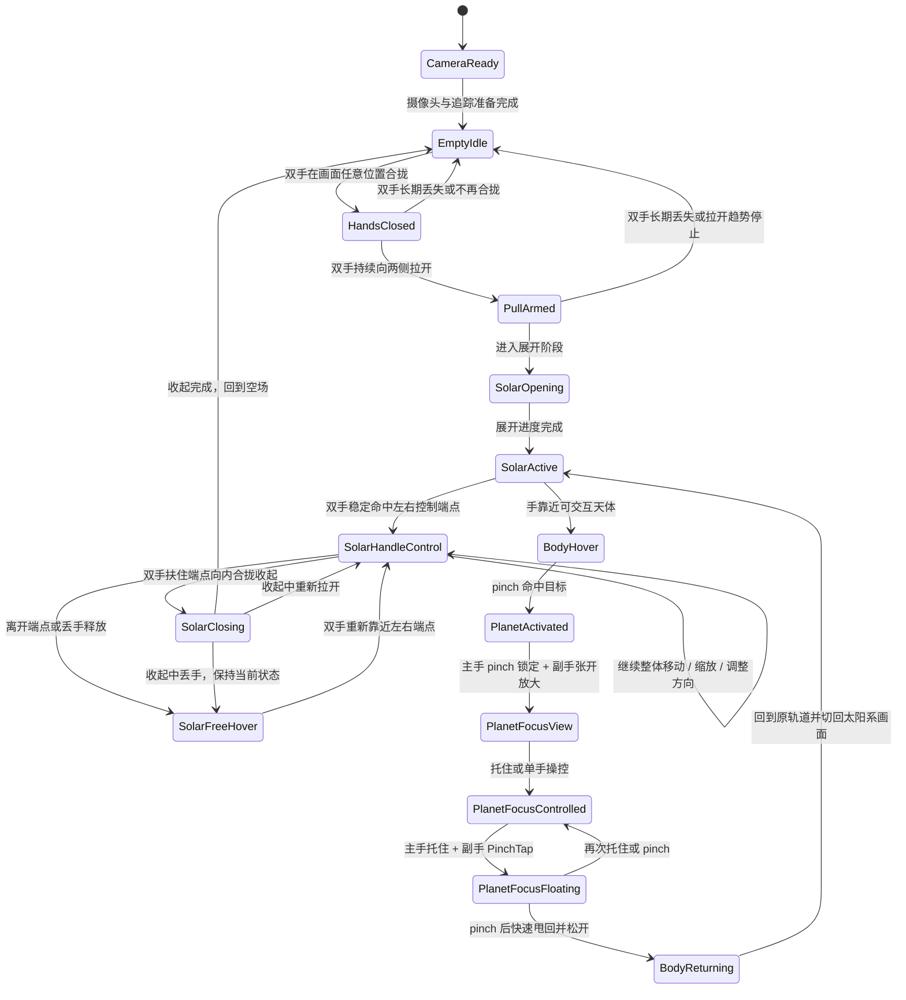
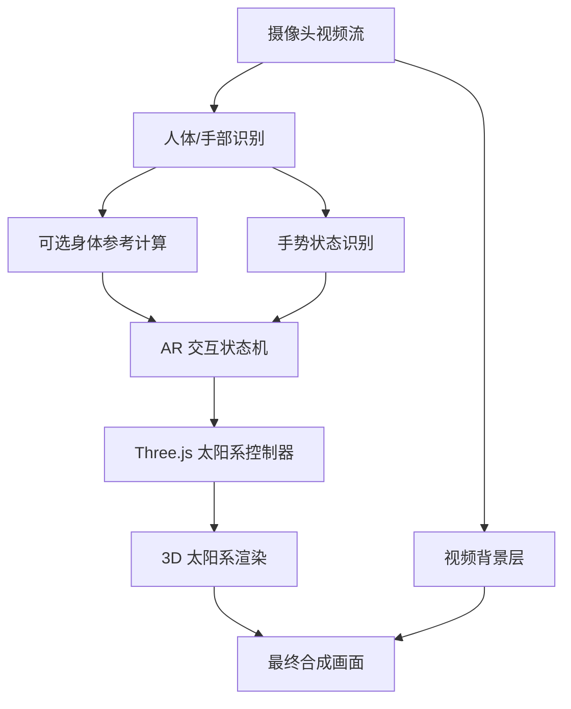

# 摄像头 AR 太阳系手势交互 Demo 产品需求文档

版本：v0.5
日期：2026-06-23
阶段：MVP 产品需求设计  
目标形态：可演示的实时摄像头 AR 交互 Demo

## 1. 项目概述

本项目旨在制作一个基于普通摄像头的实时 AR 视觉交互 Demo：用户打开摄像头后，画面中显示用户本人。初始画面没有任何可见 3D 模型，用户需要在摄像头可见画面任意位置将双手合拢或双拳紧靠，然后向两侧拉开，太阳系会随着双手距离被“拉”出来，并展开为可被双手控制、松手后停在释放位置的 3D 太阳系。

展开过程中，太阳系的左右两端需要像吸附在用户双手上一样跟随手部位置移动。展开完成并释放后，太阳系保持自由悬浮；用户可以重新扶住左右端点进行整体把手控制和反向收起，也可以在 `SolarFreeHover` 中使用 M5.5 单手手势放大、缩小、复位和平移太阳系画面，便于观察放大后的局部。

用户可以 hover 并 pinch 激活水星、金星、地球、火星、木星、土星、天王星、海王星以及月球。行星激活后，主手保持 pinch 锁定目标，副手做五指张开的放大动作进入单颗行星画面。单颗行星画面中，当前行星始终保持自转，背景太阳系弱化并锁定交互但保留基础动效。用户可以对行星放大、缩小、平移、托住移动、确认放下并让其悬浮在当前位置。只有明确的甩回动作会让行星回到原轨道，并在回轨动画完成后切回太阳系画面。

项目第一阶段不追求真实空间 AR 锚定，而是以普通摄像头画面为背景，通过人体姿态识别、手部关键点识别和 3D 渲染叠加，模拟出“太阳系像一个可被双手拉开、托住、移动并在松手处自由悬浮的空间物体”的视觉效果。

## 2. 一句话定义

一个打开摄像头即可体验的手控 AR 太阳系：初始无 3D 模型，用户双手在画面任意位置合拢后拉开太阳系，并能让它在松手位置自由悬浮、重新扶住端点收起、用单手放大/缩小/复位/平移观察、激活行星进入单颗行星画面、悬浮展示和甩回轨道。

## 3. 产品目标

### 3.1 MVP 目标

MVP 需要证明以下体验成立：

1. 摄像头画面中可以实时看到用户本人。
2. 初始画面没有任何可见 3D 太阳系、行星、奇点或星云模型。
3. 用户双手在摄像头可见画面任意位置合拢并向两侧拉开时，太阳系随手部位置被拉出。
4. 拉开过程中，太阳系的左右边界或展开端点需要吸附在双手位置上。
5. 太阳系展开后不能固定在屏幕中心；可以借助身体相对参考获得 AR 感，但松手后应停在用户释放的位置。
6. 用户重新扶住左右端点后，可以继续整体把手控制、松手自由悬浮或反向收起；当前不再把双手拉远/靠近作为太阳系观察缩放的产品验收语义。
7. 太阳系松手悬浮后，用户可以用单手五指张开/收拢来放大或缩小太阳系画面，收拢成拳保持约 2 秒恢复默认大小和位置。
8. 太阳系松手悬浮后，用户可以用单手推动平移观察放大后的局部；这套 M5.5 单手观察控制取代旧版掌心朝前“推拉玻璃窗”缩放和掌心朝上整体旋转语义。
9. 用户可以 hover 并 pinch 激活水星、金星、地球、火星、木星、土星、天王星、海王星和月球。
10. 主手 pinch 锁定行星时，副手五指张开可进入单颗行星画面。
11. 被激活行星停止原轨道公转但始终保持自转，其他行星继续正常公转和自转。
12. 单颗行星画面中，背景太阳系弱化显示并锁定交互，但保留基础动效。
13. 用户可以对当前行星进行单手放大、缩小、平移和托住移动。
14. 主手托住行星时，副手在屏幕内完成一次 PinchTap 可确认放下；行星悬浮在当前位置，仍停留在单颗行星画面，不回轨。
15. 用户再次 pinch 当前悬浮行星并向原轨道目标快速甩出，松开 pinch 后行星飞回原轨道；回轨完成后切回太阳系画面并解除太阳系交互锁定。
16. 整个体验可以稳定录制 30-60 秒演示视频。

### 3.2 非目标

MVP 暂不追求：

1. 真正的空间定位 AR。
2. 多人同时交互。
3. 精确物理模拟。
4. 天文学比例完全真实。
5. 行星真实轨道倾角、速度和距离的科学级还原。
6. 手指毫米级精准激活。
7. 移动端、Vision Pro、Quest 等 XR 设备适配。
8. 商业展厅级稳定性。
9. 复杂天文科普信息系统。
10. 单颗行星画面中星球之间的真实碰撞模拟。

## 4. 目标用户与使用场景

### 4.1 目标用户

| 用户类型 | 需求 |
|---|---|
| 创作者/演示者 | 做出一段一眼看懂的炫酷交互视频 |
| 科技课程讲解者 | 用身体和手势讲解太阳系、行星、宇宙尺度 |
| Demo 制作者 | 快速验证 AR 手势交互玩法 |
| 互动视觉爱好者 | 体验摄像头驱动的 3D 空间交互 |

### 4.2 核心使用场景

用户打开网页或桌面应用，允许摄像头权限。画面中只出现用户本人和必要的轻量 UI 提示，不出现任何 3D 太阳系模型。用户将双手或双拳在摄像头可见画面任意位置合拢，然后向左右拉开。系统基于双手相对位置和手部移动方向识别启动手势，不要求双手靠近胸前、肩膀或胸前锚点。识别成功后，在双手之间生成太阳系展开动画：太阳、轨道、星球和星云随双手距离逐渐出现。

展开完成后，太阳系保持在双手拉开形成的位置；用户松开整体双手控制后，它停在松手前的最后稳定位置、大小和朝向。用户可以继续通过双手重新扶住左右端点进行整体把手控制或反向收起，也可以在松手悬浮状态下用单手放大、缩小、复位和平移太阳系画面。旧版“双手距离缩放、掌心朝前推拉玻璃窗缩放、掌心朝上整体旋转”不再是当前产品验收语义。用户靠近某颗行星或月球时，该天体高亮；主手 pinch 命中目标后锁定该天体，副手做五指张开放大动作进入单颗行星画面。单颗行星画面中，当前行星始终自转，可被放大、缩小、平移和托住移动；确认放下后仍悬浮在当前位置。只有用户再次 pinch 并做出明确甩回动作时，该行星才带尾迹返回原轨道。

## 5. 核心体验原则

### 5.1 第一眼要像 AR

太阳系不能只是放在屏幕中央。展开时可以使用身体相对参考增强 AR 感，但整体对象一旦被双手释放，就应保持在释放位置自由悬浮，不因胸前锚点或身体移动自动吸回。

### 5.2 开始时必须是空场

初始阶段不显示 3D 太阳、星球、轨道、星云或奇点。用户需要通过双手动作把太阳系“召唤”出来。这样开场更有仪式感，也更符合“从双手之间拉开一个太阳系”的核心设想。

允许存在以下非 3D 辅助元素：

1. 摄像头画面。
2. 极轻量的 2D 提示文字。
3. 调试模式下的手部关键点。

不允许存在以下初始元素：

1. 发光奇点。
2. 预先显示的太阳。
3. 预先显示的轨道。
4. 预先显示的星云背景。
5. 任何漂浮的 3D 装饰物。

### 5.3 展开必须跟手

太阳系不是触发后播放一段固定动画，而是要被双手“拉开”。展开宽度、展开进度和视觉张力都应由双手距离驱动。用户手停住，展开也应在对应阶段停住或缓慢保持；用户继续拉开，太阳系继续扩展。

### 5.4 太阳系观察控制以 M5.5 单手语义为准

当前 MVP 的太阳系观察控制以 `SolarFreeHover` 后的单手语义为准：五指张开放大、五指收拢缩小、收拢成拳保持约 2 秒复位、单手推动平移。旧版掌心朝前“推拉玻璃窗”缩放和掌心朝上整体旋转属于已退役的 M5 语义，除非用户明确重新启用，否则不作为当前产品验收标准。

如果未来重新加入任何整体太阳系旋转，旋转仍必须表现为空间旋转，而不是图片在屏幕上绕中心点做 2D 转盘旋转。

### 5.5 行星焦点是观赏状态，不是抓起后立刻回收

被激活的星球或月球应允许用户进入单颗行星画面进行观赏。激活、进入焦点画面、放大、缩小、平移、托住移动、放下悬浮期间，该行星都应保持自转。确认放下只表示解除手控，行星仍停留在单颗行星画面的当前位置，不自动回到太阳系画面或原轨道。只有用户再次 pinch 并做出明确甩回动作，系统才将其送回轨道并切回太阳系画面。

## 6. 交互动作与系统反馈

| 动作 | 用户直觉 | 系统反馈 |
|---|---|---|
| 双手在画面任意位置合拢/双拳紧靠 | 准备打开 | 进入双手合拢状态，不播放太阳系动画，也不显示 3D 模型 |
| 双手向两侧拉开 | 从双手之间拉出太阳系 | 太阳系两端吸附双手并随距离展开 |
| 双手从展开两端向内合拢 | 把太阳系收回双手之间 | 太阳系随手距反向缩放并收起，最终回到空场 |
| 双手从太阳系两端松开 | 把物体留在空中 | 太阳系保持在松手前的稳定位置、大小和朝向 |
| 双手重新靠近太阳系两端 | 再次扶住物体 | 进入整体太阳系控制状态，不要求 pinch 某颗星球 |
| 双手扶住端点并向内合拢 | 收起太阳系 | 进入 `SolarClosing`，完成后回到空场 |
| 太阳系悬浮后单手五指张开 | 放大太阳系画面 | 太阳系整体继续放大，允许局部移出屏幕 |
| 太阳系悬浮后单手五指收拢 | 缩小太阳系画面 | 太阳系整体缩小；收拢成拳保持 2 秒恢复默认画面 |
| 太阳系悬浮后单手推动 | 平移观察局部 | 太阳系画面按手掌中心移动方向平移 |
| 主手 pinch 命中行星 | 选中目标 | 目标行星进入激活状态，停止原轨道公转但继续自转 |
| 主手持续 pinch + 副手张开放大 | 进入单颗行星画面 | 当前行星成为主角，背景太阳系弱化并锁定交互 |
| 单颗行星画面中五指张开/收拢 | 放大或缩小当前行星 | 当前行星持续自转并调整显示大小 |
| 单颗行星画面中单手推动 | 调整展示位置 | 当前行星在屏幕内平移 |
| 手掌打开停在行星下方 | 托住行星 | 行星跟随托住手移动，且不会移出屏幕 |
| 主手托住 + 副手 PinchTap | 确认放下 | 行星悬浮在当前位置，仍停留在单颗行星画面 |
| 再次 pinch + 快速甩向原轨道目标 + 松开 | 送回轨道 | 行星带尾迹回到原轨道，完成后切回太阳系画面 |

## 7. MVP 功能范围

### 7.1 摄像头与真人背景

功能描述：

1. 打开应用后请求摄像头权限。
2. 摄像头画面以完整画面显示，作为 AR 预览背景层。MVP 默认使用 16:9 预览容器承载 16:9 摄像头输入。
3. 支持前置镜像显示，用户看到自己时符合自拍直觉。
4. 摄像头画面上叠加透明 WebGL Canvas，用于后续显示 3D 太阳系和交互特效。
5. 视频、WebGL Canvas 和坐标调试/交互 overlay 必须共享同一显示尺寸，避免手势识别画面和用户看到的画面错位。
6. 摄像头预览使用 `object-fit: contain`，保留完整画面；不得使用 `cover` 将 16:9 摄像头输入裁切成接近 1:1、竖屏或其他非源比例区域。

验收标准：

1. 用户允许权限后，1-3 秒内显示摄像头画面。
2. 摄像头画面不明显拉伸变形，也不因填满页面而被裁切放大。
3. 初始状态无任何可见 3D 模型。
4. 调试面板可显示摄像头原始尺寸、页面显示尺寸、显示比例、`object-fit` 和 Canvas 尺寸，用于校验显示与渲染层对齐。

### 7.2 身体相对参考

功能描述：

1. 识别用户左右肩位置。
2. 根据左右肩中心点估算身体相对参考点，用于调试和可选的初始 AR 视觉放置。
3. 身体相对参考不得作为启动、松手、重新扶住、缩放、旋转或自由悬浮的必要条件。
4. 太阳系被用户释放后，必须保持最后稳定 transform，而不是自动跟随胸前锚点移动。
5. 由于当前里程碑（M4 之前）身体相对参考不参与任何必要判定，姿态识别（PoseLandmarker）默认关闭，以把算力让给手部追踪、提升手势稳定性；调试面板此时显示“未识别到身体”。当 M4 及以后真正使用身体相对放置时，再开启并以降频方式运行。

身体参考估算方式：

```text
bodyRefX = (leftShoulder.x + rightShoulder.x) / 2
bodyRefY = (leftShoulder.y + rightShoulder.y) / 2 + shoulderDistance * 0.35
bodyRefZ = 视觉模拟深度，不作为真实空间深度
```

验收标准：

1. 肩膀关键点可用于调试身体参考，但不影响 hand-only 启动。
2. 用户松开整体控制后，太阳系保持释放位置，不吸回胸前或屏幕中心。
3. 肩膀短暂丢失时，已经释放或被双手控制的太阳系不应突然消失或跳动。

### 7.3 初始状态：空场

功能描述：

1. 初始状态只显示摄像头画面。
2. 不显示奇点、轨道、太阳、星球、星云或粒子。
3. 可用极简 2D 提示引导用户双手或双拳在摄像头可见画面任意位置合拢，再向两侧拉开。
4. 系统持续检测双手是否在画面内合拢；该启动检测不得要求双手靠近胸前、肩膀或胸前锚点。

验收标准：

1. 打开摄像头后，画面中没有任何 3D 太阳系元素。
2. 用户不做动作时，系统不会自动出现太阳系。
3. 用户能通过轻量提示理解需要双手先合拢再拉开。

### 7.4 双手吸附拉开太阳系

功能描述：

1. 系统识别左右手掌、手腕或手部中心点。
2. 当双手在摄像头可见画面任意位置合拢并向两侧拉开时，太阳系进入 opening 状态。
3. opening 状态下，太阳系的左右展开端点绑定到左右手位置。
4. 双手距离决定太阳系展开进度。
5. 双手在拉开过程中停住，展开进度也应相对停住，而不是继续自动播完。
6. 双手继续拉开，太阳系继续从中心向两端扩展。
7. 双手/双拳保持合拢但没有拉开时，不显示太阳系，也不播放任何 3D 动画。
8. 展开完成或用户松开整体双手控制后，太阳系保持在松手前的最后稳定位置、缩放和朝向，不自动回到屏幕中心，也不突然吸回胸前锚点。
9. 当太阳系已经展开且双手扶住左右端点时，双手从拉开状态向内合拢应驱动反向收起动画；收起进度同样由手距驱动。
10. 反向收起完成后，太阳系 3D 内容全部隐藏，画面回到启动前的空场状态。

视觉表现建议：

1. 双手刚开始分离时，先出现一条短促的发光空间裂缝或轨道骨架。
2. 随双手距离增大，太阳从双手之间的中点附近显现。
3. 行星轨道由内到外被拉开。
4. 行星在对应轨道上逐个显现。
5. 星尘和星云随展开进度从中心扩散出来。
6. 反向收起时，太阳、轨道、行星、星尘和星云按展开逻辑反向消失。

触发规则建议：

```text
条件 1：检测到左右手
条件 2：双手初始距离小于画面归一化宽度/对角线的近距阈值，或双拳/双手明显紧靠
条件 3：启动检测只使用双手相对位置和运动趋势，不使用胸前锚点、肩膀或身体姿态作为必要条件
条件 4：双手距离在 0.2-1.5 秒内持续增大
条件 5：最终双手距离相对初始手距达到足够增量
条件 6：双手/双拳重叠导致一只手短时间丢失时，可以锁存最近一次有效的双手合拢证据；但不能在没有近期双手证据的情况下用单手启动
```

展开进度建议：

```text
openProgress = clamp(
  (currentHandDistance - startHandDistance) /
  (targetHandDistance - startHandDistance),
  0,
  1
)
```

反向收起建议：

```text
closeProgress = 1 - openProgress
```

说明：无论展开还是收起，视觉进度都应跟随当前手距；双手停住时，展开/收起都应停住或保持，不应自动完成。

验收标准：

1. 用户做出明显“双手先合拢再拉开”动作时，80% 以上可成功触发，无论双手位于胸前、头顶、身体侧边或画面内其他可见位置。
2. 展开过程能明显看出太阳系两端跟随双手位置。
3. 用户拉得快，太阳系展开更快；用户拉得慢，太阳系展开更慢。
4. 触发失败时，不应出现乱闪或误爆发。
5. 双手只保持紧握不拉开时，不出现任何太阳系动画或 3D 内容。
6. 用户松开整体双手控制后，太阳系悬浮停留在松手前的位置、大小和朝向。
7. 用户重新扶住左右端点并向内合拢双手时，太阳系随手距反向收起。
8. 反向收起完成后，太阳系消失，画面回到只显示摄像头和 2D UI 的空场。

### 7.4.1 整体太阳系松手与重新扶住

功能描述：

1. 太阳系展开后，系统需要判断用户是否仍在“扶住”太阳系两端。
2. 松手的主要判断来自手型：双手五指明显张开、手指伸展、grip-pose 分数降低，并稳定持续一小段时间后，系统才进入松手候选。
3. 张开手松手一旦被接受，需要锁存释放意图：即使用户慢慢收回手、手指在收回过程中自然弯曲，也不能重新把端点粘回手上。
4. 整体释放不是关闭太阳系，而是让太阳系悬浮在松手前的最后稳定 transform 上。
5. 用户再次把双手靠近太阳系左右端点时，系统可以重新进入整体控制状态。
6. 重新扶住整体太阳系不要求 pinch，因为 pinch 主要用于后续激活单个天体。
7. 张开手释放后，重新扶住必须等双手先明确离开冻结端点，再重新靠近冻结端点；不能在用户慢慢撤手时自动重新扶住。
8. 重新扶住应允许一个较宽容的磁吸区：M3.5 协议验证阶段使用 debug-only 2D 虚拟端点；M4 可见 3D 太阳系接入后，重新扶住以太阳系自身左右 3D 控制端点为准，用户双手大致回到冻结端点附近且左右关系正确时，可以重新进入整体控制。
9. 整体控制需要使用迟滞和保持窗口，避免端点附近反复进出控制状态。
10. 重新扶住后，如果双手向内合拢并接近闭合阈值，系统应进入整体收起状态，而不是把这个动作误判为单纯缩小或激活单个天体。
11. 双手微弯、像握住两侧把手时，应保持整体控制并继续让端点跟手；不能把轻微弯曲误判为松手。
12. 掌心朝上、手指微弯的托举姿态可作为历史协议/debug 信号，用于保护当前端点握持不被张开手松手误抢；它不再表示当前产品中的整体旋转控制。
13. 整体控制意图优先级为：端点握持/防误松手优先，反向收起其次，张开手松手最后。
14. 双手完全丢失、端点明显不匹配或整体控制置信度过低可以作为兜底松手信号，但不应取代张开手这一主要松手手势。

验收标准：

1. 用户松开双手后，太阳系不会消失、不会回到屏幕中心，也不会突然重置到胸前锚点。
2. 用户重新把双手放到太阳系两侧端点附近后，可以继续控制整体太阳系。
3. 整体控制和单个行星 pinch 激活不会互相误触发。
4. 双手从左右端点向内合拢可以触发整体收起，并最终回到空场。

### 7.4.2 接入 3D 前的整体交互协议层

功能描述：

1. 在 MediaPipe 手部关键点和未来 Three.js 太阳系控制器之间，需要有一层明确的整体交互协议。
2. 协议层输入手部中心、手距、手距速度、双手方向向量、掌心朝向基础量、张开手/握持手型分数、pinch 倾向和虚拟端点位置。
3. 协议层输出整体控制状态、控制置信度、松手置信度、重新扶住置信度、反向收起意图、历史缩放/旋转诊断、张开手松手手势、释放稳定时长、松手阻止原因、握持保护状态、重新扶住原因和已接受释放锁状态。
4. 该协议层不得直接渲染太阳、行星、轨道、星云、粒子、奇点或任何 3D 模型。
5. 在接入可见 3D 太阳系之前，可以只在 debug 面板中显示协议输出，并在 debug overlay 中显示 2D 虚拟端点。
6. 虚拟端点表示未来太阳系视觉左/视觉右把手的位置：整体控制时随双手更新；进入松手候选或自由悬浮后冻结在最后稳定位置；重新扶住时用于判断双手是否回到视觉左右端点附近。
7. 整体控制状态至少包括 `Inactive`、`VirtualOpeningHandle`、`SolarHandleControl`、`ReleaseCandidate`、`SolarFreeHover`、`ReGripCandidate` 和 `SolarClosing`。
8. 掌心朝向只作为意图置信度加分，不作为硬性门槛；普通摄像头下掌心法线不应被当作精确 3D 传感器使用。
9. 整体控制意图需要与单个行星 pinch 激活意图区分；强 pinch 倾向应降低整体控制置信度，而不是增强整体控制。
10. 视觉左/视觉右端点以用户看到的镜像画面为准，不等同于 MediaPipe handedness 的 left/right。
11. 页面右上角应有简短中文状态说明，位于 Debug 按钮左侧，用于把当前系统理解的用户意图、判断原因和核心参数直接展示出来，方便用户对照真实动作定位误判。
12. M4 可见 3D 太阳系接入后，右上角状态说明应以当前 `interactionState` 和太阳系控制器输出的 `solarReason` / `openProgress` / scale 为准；旧 `Whole control`、`Lock`、`Re-grip`、`Transition` 等协议值只保留在 Debug 面板中。

验收标准：

1. Debug 面板能显示整体控制状态和控制/松手/重新扶住置信度，并明确区分 `Startup state` 与 `Whole control`。
2. Debug 面板能显示反向收起意图以及历史缩放/旋转诊断。
3. Debug 面板能显示左右掌心法线、掌心朝向摄像头分数和掌心朝上分数。
4. Debug 面板能显示视觉左/视觉右虚拟端点以及端点是否匹配。
5. Debug 面板能显示左右手 open-hand 分数、grip-pose 分数、伸展手指数、松手手势是否激活、释放稳定时长、松手阻止原因、握持保护状态、重新扶住原因以及释放锁是否开启。
6. Debug overlay 只在 debug 模式下显示 2D 虚拟端点，不显示任何 3D 太阳系内容。
7. 右上角中文状态说明应以当前 `interactionState` 和最新太阳系控制器输出为准，显示类似“太阳系已展开”“正在控制太阳系”“太阳系悬浮中”“正在收起太阳系”的当前解释，并列出 `openProgress`、`Solar scale`、`solarReason` 等核心参数。旧 `Whole control`、`Lock`、`Re-grip`、`Transition` 等整体协议值只作为 Debug 面板诊断信息，不应作为用户可见状态卡的太阳系控制解释。
8. 真实摄像头验证后，若端点半径、掌心分数、张开手阈值或意图阈值不稳定，应先调试该协议层，再进入 Milestone 4。

### 7.4.3 手势诊断与会话自适应阈值

功能描述：

1. 在接入太阳系 3D 内容前，系统需要统一计算手部基础特征，而不是让 startup、整体控制、后续行星激活各自重复解释 MediaPipe landmarks。
2. 基础特征层应输出：左右手中心、手距、中点、双手轴向方向、双手轴向角度、手距速度、平均手掌尺度、追踪置信度、合拢意图分数和拉开意图分数。
3. 系统应基于当前摄像头会话进行临时校准，包括手掌尺度、首次稳定合拢距离和自然拉开距离。
4. 合拢阈值、拉开增量、端点半径、重新扶住磁吸半径和反向收起阈值应优先使用会话内校准值推导，而不是只使用固定归一化数值。
5. 会话校准默认只存在内存中；刷新页面后可以重新校准。除非用户明确要求，不保存长期历史数据，不引入账号、后端或云端数据。
6. startup 和整体控制协议应输出结构化跳转原因，例如等待合拢、合拢证据稳定中、拉开增量达标、释放锁等待撤手、重新扶住稳定中等。
7. Debug 面板应显示基础特征、会话校准阈值、endpoint hit score、tracking confidence、startup reason 和 whole-system reason。
8. Debug recorder 可以记录结构化 landmarks、基础特征、校准值、意图分数、状态和跳转原因，用于复盘误判；不得记录原始摄像头视频，也不得上传数据。
9. 该诊断层仍不得渲染太阳、行星、轨道、星云、粒子、奇点或任何 3D 模型。

验收标准：

1. Debug 面板可看到手轴角度、追踪置信度、合拢/拉开分数和基础识别原因。
2. Debug 面板可看到手掌尺度、闭合/拉开校准值、合拢阈值、端点半径和收起阈值。
3. 启动手势、重新扶住和反向收起使用会话自适应阈值；真实摄像头测试时不应比固定阈值更容易抖动。
4. 状态说明或 Debug 面板可以解释为什么进入或没有进入 `HandsClosed`、`PullArmed`、`ReleaseCandidate`、`SolarFreeHover`、`ReGripCandidate` 或 `SolarClosing`。
5. Debug recorder 导出的 JSON 只包含结构化手势数据和计算结果，不包含 raw video frame。

### 7.4.4 M4 前代码占位太阳系视觉层

功能描述：

1. 在 Milestone 4 正式接入手势拉开展开前，可以先实现一个全代码占位太阳系视觉层，用于验证 Three.js 球体、轨道、公转、自转、月球绕地、土星环和程序花纹。
2. 该占位层默认不得显示；普通启动路径仍必须保持初始空场。
3. 允许使用开发测试入口 `?solarPreview=1` 直接显示完整占位太阳系，方便不依赖摄像头和手势调试视觉效果。
4. 占位层必须是数据驱动结构，包含太阳、水星、金星、地球、月球、火星、木星、土星、天王星和海王星。
5. 程序花纹只是临时材质来源；后续准备好贴图素材后，应只替换材质来源或数据配置，不改变交互状态机、行星激活逻辑、焦点逻辑或回轨逻辑。
6. M4 后续接入时，应将手势得到的 `openProgress`、位置、缩放和旋转 transform 连接到该占位层，而不是重新实现一套太阳系视觉对象。

验收标准：

1. 默认页面不显示任何 3D 太阳系内容。
2. `?solarPreview=1` 可以直接显示完整占位太阳系。
3. 每个主要天体有明显程序花纹，自转肉眼可见。
4. 行星绕太阳公转，月球绕地球公转，土星有清晰环。
5. 占位层可被隐藏、显示、更新、设置展开进度、设置 transform，并可正确释放 Three.js 资源。

### 7.5 太阳系自由悬浮后的单手观察控制

功能描述：

1. 该控制只在太阳系进入 `SolarFreeHover` 后生效。
2. 单手五指张开映射为太阳系画面放大。
3. 单手五指收拢映射为太阳系画面缩小。
4. 收拢成拳并保持约 2 秒，恢复默认太阳系大小和位置。
5. 单手左/右/上/下推动映射为太阳系画面平移。
6. 双手端点控制期间，该单手观察控制不得触发。
7. 放大后的太阳系可以部分移出屏幕，但必须保留可恢复的默认复位路径。

参数建议：

| 参数 | 建议值 |
|---|---:|
| 最小观察缩放 | 0.6x |
| 默认观察缩放 | 1.0x |
| 最大观察缩放 | 2.5x |
| 复位握拳时间 | 约 2s |
| 平滑系数 | 0.12-0.25 |

验收标准：

1. `SolarFreeHover` 中，单手五指张开会放大太阳系。
2. 单手五指收拢会缩小太阳系。
3. 收拢成拳保持约 2 秒会恢复默认大小和位置，并让端点保持可见。
4. 单手推动可以平移放大后的太阳系画面，无需重新进入双手端点控制。
5. 双手端点控制期间，单手太阳系观察不会触发。
6. 慢速手势下，缩放/平移分类不会明显闪烁。

### 7.6 旧版整体缩放/旋转语义退役说明

功能描述：

1. 旧版“双手距离变大/变小控制太阳系观察缩放”不再是当前产品验收语义。
2. 旧版“掌心朝前左右推拉像推拉玻璃窗一样缩放”不再是当前产品验收语义。
3. 旧版“掌心朝上轻轻旋转触发整体太阳系 3D 旋转”不再是当前产品验收语义。
4. M3.5 中已有的 palm normal、scale intent、rotation intent 等字段可以暂时保留为历史 debug/诊断信息，用于解释旧协议或避免错误松手。
5. 除非用户明确重新启用，不应把这些旧语义扩展进 `SolarHandleControl` 的新实现任务。

验收标准：

1. 当前实现计划以 7.5 / Milestone 5.5 的单手观察控制作为太阳系放大、缩小、复位和平移路径。
2. 文档、TODO 和 agent 规则不再把旧版掌心/双手动作列为待实现验收项。
3. 旧协议 debug 字段与当前产品控制语义在文档中有明确区分。

### 7.7 可交互天体列表

MVP 可交互对象包括：

| 编号 | 天体 | 交互要求 |
|---|---|---|
| P1 | 水星 | 支持 hover、pinch 激活、单颗行星画面、悬浮、甩回 |
| P2 | 金星 | 支持 hover、pinch 激活、单颗行星画面、悬浮、甩回 |
| P3 | 地球 | 支持 hover、pinch 激活、单颗行星画面、悬浮、甩回 |
| P4 | 火星 | 支持 hover、pinch 激活、单颗行星画面、悬浮、甩回 |
| P5 | 木星 | 支持 hover、pinch 激活、单颗行星画面、悬浮、甩回 |
| P6 | 土星 | 支持 hover、pinch 激活、单颗行星画面、悬浮、甩回，保留土星环 |
| P7 | 天王星 | 支持 hover、pinch 激活、单颗行星画面、悬浮、甩回 |
| P8 | 海王星 | 支持 hover、pinch 激活、单颗行星画面、悬浮、甩回 |
| M1 | 月球 | 支持 hover、pinch 激活、单颗行星画面、悬浮、甩回，默认围绕地球运动 |

说明：

1. MVP 允许九个天体使用简化纹理和非真实比例。
2. 土星需要保留明显的环，避免识别度不足。
3. 月球默认作为地球的子对象运动，被激活进入单颗行星画面后可从地月系统中临时脱离。
4. 同一时间只允许激活或聚焦一个天体，降低交互冲突。

验收标准：

1. 九个天体都可以被高亮和激活。
2. 激活不同天体时，标签名称准确。
3. 月球可与地球区分，不被地球交互热区完全覆盖。

### 7.8 星球选择与高亮

功能描述：

1. 当手部靠近某个可交互天体的屏幕投影位置时，该天体进入 hover 状态。
2. hover 状态表现为星球外圈光晕、名称标签和轨道线轻微变亮。
3. 当多个天体接近手部时，优先选择屏幕距离最近且热区权重最高的天体。
4. 为小天体扩大交互热区，避免水星、月球过难激活。

验收标准：

1. 用户手靠近目标天体时，目标天体明显高亮。
2. 高亮不会在多个天体之间疯狂跳动。
3. 选中反馈足够明显，录屏可看清。

### 7.9 Pinch 激活行星

功能描述：

1. 使用拇指和食指距离判断 pinch 手势。
2. 当 pinch 发生且手部靠近高亮天体的边界或扩展热区时，该天体进入 `PlanetActivated` 状态。
3. 被激活天体停止原轨道公转，但继续保持自转。
4. 其他天体继续正常公转和自转。
5. 激活期间，整个太阳系背景不被拖动、不被缩放，避免误操作。

pinch 判断建议：

```text
pinchDistance = distance(thumbTip, indexFingerTip)
pinchStart = pinchDistance < handScale * 0.18
pinchEnd = pinchDistance > handScale * 0.28
```

说明：开始和结束阈值应使用不同数值，避免手势在临界点反复闪烁。

验收标准：

1. 用户 pinch 命中高亮天体时，该天体进入激活状态。
2. 激活反馈清楚，例如边界光环锁定、标签固定或原轨道占位点出现。
3. 激活状态不会拖动或缩放整个太阳系。
4. 被激活天体停止公转但保持自转。

### 7.10 单颗行星画面

功能描述：

1. 主手持续 pinch 锁定已激活天体时，副手做五指张开的放大动作，进入 `PlanetFocusView`。
2. `PlanetFocusView` 中，当前行星成为主角，背景太阳系弱化显示。
3. 背景太阳系交互锁定，不能被误拖动、误缩放或误旋转。
4. 背景太阳系保留基础动效，其他行星可继续公转和自转。
5. 当前行星在激活、焦点画面、放大、缩小、平移、托住移动、悬浮期间始终保持自转。

建议交互：

| 操作 | 效果 |
|---|---|
| 主手 pinch 锁定行星 | 行星进入激活状态，停止原轨道公转并保持自转 |
| 副手五指张开 | 进入单颗行星画面 |
| 单手五指张开 | 放大当前行星 |
| 单手五指收拢 | 缩小当前行星 |
| 收拢成拳保持 2 秒 | 恢复当前行星默认大小和默认位置 |
| 单手左/右/上/下推动 | 平移当前行星展示位置 |

验收标准：

1. 主手 pinch 锁定 + 副手张开放大可以进入单颗行星画面。
2. 单颗行星画面中，当前行星明显成为主角。
3. 背景太阳系弱化并锁定交互，但保留基础动效。
4. 当前行星在所有焦点操作中持续自转。
5. 行星缩放和平移不影响整个太阳系 transform。

### 7.11 托住、确认放下与悬浮

功能描述：

1. 产品语义上，用户可以用掌心向上“托住”当前行星。
2. 技术判断不强制依赖真实掌心朝上，而使用更稳定的替代条件：手掌大致打开、手掌中心位于行星下方、距离行星底部较近、低速停留约 300-500ms。
3. 托住后，行星跟随托住手移动。
4. 行星不能移出屏幕外；当手部移动到屏幕外时，行星悬停在最近的屏幕边缘合法位置。
5. 主手托住行星时，副手在屏幕内完成一次 `PinchTap`，确认放下行星。
6. `PinchTap` 是拇指和食指快速捏合后松开的确认动作，不需要命中行星边界或确认热区。
7. 确认放下后，行星悬浮在当前位置，继续自转。
8. 确认放下不回太阳系画面、不回原轨道、不解除背景太阳系交互锁定。

状态可理解为：

```text
PlanetFocusControlled
→ 主手托住 + 副手 PinchTap
→ PlanetFocusFloating
```

验收标准：

1. 托住识别稳定，不要求用户精确摆出可被 MediaPipe 完美判定的掌心朝上。
2. 托住后，当前行星跟随手移动且不会移出屏幕。
3. 副手 PinchTap 可以确认放下。
4. 放下后，行星停留当前位置并继续自转。
5. 放下后仍停留在单颗行星画面，背景太阳系继续弱化并锁定交互。

### 7.12 甩回原轨道

功能描述：

1. 当当前行星处于 `PlanetFocusFloating` 或可再次 pinch 的焦点状态时，用户可以再次 pinch 命中该行星。
2. 用户捏住当前行星后，朝背景中的原轨道目标方向快速甩出，并在甩动末端松开 pinch。
3. 甩回动作通过 pinch 状态、手部速度、运动方向和松开时机共同判断。
4. returning 状态下，行星带尾迹飞回原轨道位置。
5. 回轨动画完成后，当前行星恢复原始轨道层级和公转，切回太阳系画面，并解除太阳系交互锁定。

甩回识别建议：

```text
throwVelocity = handVelocityAtRelease
throwStart = isPinchingFocusedBody && handVelocity > velocityThreshold
throwConfirm = pinchEnd within 0.2s after throwStart
throwDirectionScore = dot(normalizedHandVelocity, directionToOrbitTarget)
```

容错策略：

1. 如果速度不足，只保持 `PlanetFocusFloating`，不回轨。
2. 如果方向没有明显指向原轨道目标，降低回轨置信度。
3. 单颗行星画面中应显示弱光原轨道目标点或方向提示，帮助用户理解甩回方向。
4. 对小天体放宽命中和甩回阈值，避免月球过难操作。

验收标准：

1. 普通放下或低速移动不会回轨。
2. 明确 pinch + 快速甩向原轨道目标 + 松开会触发回轨。
3. 回轨动画流畅，有尾迹或光线反馈。
4. 回轨后天体恢复原始公转关系，单颗行星画面结束，太阳系画面恢复交互。

## 8. 视觉设计需求

### 8.1 整体风格

关键词：

1. 科幻。
2. 宇宙。
3. 真实 3D。
4. 发光轨道。
5. 手势魔法感。
6. AR 悬浮。
7. 空间感。
8. 仪式感开场。

### 8.2 太阳系视觉组成

| 元素 | MVP 要求 |
|---|---|
| 太阳 | 中心发光球体，带光晕 |
| 水星 | 小型灰色岩质星球 |
| 金星 | 黄白色云层质感 |
| 地球 | 蓝绿色纹理，带月球系统 |
| 月球 | 小型灰白球体，默认绕地球运动 |
| 火星 | 红褐色岩质星球 |
| 木星 | 大体积条纹气态行星 |
| 土星 | 带明显土星环 |
| 天王星 | 青蓝色、轴向可略倾斜 |
| 海王星 | 深蓝色气态行星 |
| 轨道 | 半透明发光圆环 |
| 星云 | 展开后出现的动态背景层 |
| 星尘 | 拉开过程中从双手中点向外扩散 |
| 标签 | hover、激活或单颗行星画面中显示天体名称 |

### 8.3 动画需求

| 动画 | 描述 |
|---|---|
| 空场待机 | 初始只显示真人摄像头画面 |
| 双手拉开 | 太阳系两端吸附双手并展开 |
| 行星公转 | 展开后行星围绕太阳缓慢运动 |
| 自转 | 天体自然自转；被激活、聚焦、缩放、平移、托住或悬浮时也保持自转 |
| 行星激活 | pinch 命中目标后锁定该天体，停止原轨道公转但保持自转 |
| 单颗行星画面 | 当前行星成为主角，背景太阳系弱化并锁定交互 |
| 悬浮自转 | 放下后停留在单颗行星画面当前位置并继续自转 |
| 甩出回轨 | 天体带尾迹返回原轨道 |
| 手部反馈 | 手靠近对象时出现小型光圈或粒子 |

## 9. 交互状态机



## 10. 技术方案建议

### 10.1 推荐 MVP 技术栈

| 模块 | 推荐方案 |
|---|---|
| 摄像头输入 | Browser MediaDevices API |
| 手部识别 | MediaPipe Hand Landmarker / Gesture Recognizer |
| 人体姿态识别 | MediaPipe Pose Landmarker |
| 3D 渲染 | Three.js |
| 前端框架 | 原生 JS 或 React |
| 动画补间 | GSAP 或 Three.js 内置插值 |
| 姿态旋转 | Quaternion / Arcball 映射 |
| Demo 形态 | Web 页面优先，后续可封装 Electron |

选择理由：

1. 普通摄像头即可体验。
2. 浏览器运行，演示门槛低。
3. Codex 可直接辅助开发、调试和迭代。
4. Three.js 更适合先做 3D 交互逻辑。
5. 后续可迁移到 TouchDesigner、Unity 或 Unreal。

### 10.2 可选升级技术栈

| 目标 | 升级方向 |
|---|---|
| 更稳定手势 | Ultraleap / 深度摄像头 |
| 更强交互产品化 | Unity |
| 更强实时视觉装置 | TouchDesigner |
| 更真实影视级画面 | Unreal Engine |
| 真空间 AR | Vision Pro / Quest / AR 眼镜 |

## 11. 系统架构



## 12. 数据与坐标映射

### 12.1 输入数据

| 数据 | 来源 | 用途 |
|---|---|---|
| 左右肩关键点 | Pose | 计算可选身体相对参考，不参与启动、松手、重新扶住或自由悬浮必要条件 |
| 左右手腕 | Hand/Pose | 判断启动手距、端点控制、反向收起和双手配对 |
| 手掌中心 | Hand | 展开端点、星球吸附位置、M5.5 单手平移 |
| 食指指尖 | Hand | 判断指向、pinch 和激活位置 |
| 拇指指尖 | Hand | 判断 pinch |
| 左右手距离 | Hand | 拉开展开、端点重新扶住和反向收起 |
| 单手手指张开程度 | Hand | M5.5 太阳系观察放大/缩小/复位 |
| 手部速度 | Hand | 判断甩出动作 |
| 手掌尺寸 | Hand | 辅助估算深度和 pinch 阈值 |
| 手掌朝向 / palm normal | Hand | 历史协议/debug 诊断、松手保护和后续明确批准的姿态意图 |
| 左右展开端点 | Solar System Controller | 判断整体太阳系是否被重新扶住 |
| 整体太阳系 transform | Solar System Controller | 松手后保持悬浮位置、缩放和朝向 |

### 12.2 2D 到 3D 映射原则

MVP 中不做真实空间深度重建，而是将手部坐标和可选身体参考从摄像头画面坐标映射到 Three.js 的 3D 场景平面，并使用相对 Z 值、手掌大小和运动规则模拟空间深度。启动、松手、重新扶住、反向收起、M5.5 单手观察控制和自由悬浮都应优先依赖手部与太阳系当前 transform；身体参考只用于可选的初始视觉放置和身体相对 AR 感。

```text
cameraX/Y: 0-1 归一化坐标
threeX = (cameraX - 0.5) * sceneWidth
threeY = -(cameraY - 0.5) * sceneHeight
threeZ = estimatedDepth or interactionPresetDepth
```

### 12.3 M5.5 单手观察映射原则

太阳系进入 `SolarFreeHover` 后，单手观察控制使用手掌中心、手指张开程度、手指张开速度、手掌中心速度和握拳保持时间。缩放手势必须带有相位锁：张开放大只消费张开阶段，张开后的自然收手不得反向触发缩小；稳定开掌后的明确收拢才触发缩小，收拢后的自然放松不得反向触发放大。

```text
spreadScore = fingerSpread / calibratedHandScale
zoomInIntent = stablePalmCenter && spreadOpeningPhase && !reboundLocked
zoomOutIntent = stablePalmCenter && stableOpenArm && spreadClosingPhase && !reboundLocked
panIntent = stableSpreadClutch && palmCenterDisplacementFromAnchor
resetIntent = contractedFistHeldForAbout2s
```

目标不是科学级空间追踪，而是让用户能稳定检查放大后的太阳系局部，并能随时通过握拳保持恢复默认视图。平移应先锁定稳定展开程度和手掌锚点，再用手掌相对位移低通跟随，避免左右推动时因单帧速度抖动而产生顿挫。

补充规则：

1. M5.5 单手观察只在 `SolarFreeHover` 中生效。
2. `SolarHandleControl` 中优先处理端点把手生命周期，包括重新扶住、松手和反向收起。
3. 单次放大或缩小结束后，必须忽略反向回弹，直到手指回到稳定中性展开区或手离开画面后重新进入。
4. 旧版 palm-forward / palms-up 字段只保留为历史 debug/诊断信息，不作为当前太阳系观察控制。

### 12.4 平滑策略

所有识别坐标都需要做平滑处理：

1. 身体参考：低通滤波，仅用于可选初始视觉放置，不作为启动、松手、重新扶住或自由悬浮必要条件。
2. 手部位置：低通滤波 + 丢帧保持；启动阶段允许短时间锁存最近一次有效双手合拢证据，以容忍双手/双拳贴近造成的一只手遮挡。
3. 展开进度：跟随手距，但限制最大变化速度。
4. M5.5 观察缩放值：限制最大变化速度。
5. 观察平移偏移：低通滤波并保留复位路径。
6. pinch 状态：使用迟滞阈值。
7. 甩出速度：使用短时间窗口均值，避免单帧误判。

## 13. 关键参数建议

| 参数 | 建议值 | 说明 |
|---|---:|---|
| 双手合拢距离阈值 | 默认约 0.15-0.22，优先由手掌尺度和会话内闭合距离校准 | 启动手势合拢判定，不应长期写死 |
| 拉开触发增量 | 默认约 0.08-0.15，优先由闭合距离和自然拉开距离校准 | 从 `HandsClosed` 进入 `PullArmed`，需实测 |
| 端点匹配半径 | 默认约 0.16-0.34，优先由手掌尺度和会话校准推导 | 用于整体控制、松手和重新扶住 |
| 反向收起阈值 | 默认约 0.19-0.34，优先由闭合距离和自然拉开距离校准 | 区分普通缩小和彻底收起 |
| 展开完成距离 | 基于起始手距的相对增量 | 太阳系完全展开，后续实测 |
| 展开进度平滑 | 0.15-0.3 | 防止手部抖动 |
| 行星激活反馈时长 | 0.15-0.35s | 需要有“目标被锁定”的感觉 |
| 悬停自转延迟 | 0.1-0.3s | 松开后自然恢复 |
| 甩出速度阈值 | 需实测 | 基于摄像头画面比例 |
| 回轨动画时长 | 0.8-1.5s | 需要优雅回归 |
| 摄像头帧率目标 | 30fps | MVP 基础要求 |
| 3D 渲染帧率目标 | 30-60fps | 低于 30fps 体验明显下降 |
| 身体参考丢失保持 | 1s | 防止可选身体参考短暂识别失败 |
| 手部丢失保持 | 2s 左右 | 防止启动合拢、拉开或激活时因短时间遮挡闪断 |
| pinch 开始阈值 | 手掌尺度 * 0.18 | 需实测调整 |
| pinch 结束阈值 | 手掌尺度 * 0.28 | 避免频繁开关 |

## 14. MVP 页面与操作流程

### 14.1 页面结构

1. 启动页：
   - 标题：AR Solar System
   - 按钮：开启摄像头
   - 简短提示：让双手保持在画面中清晰可见，双手合拢后再向两侧拉开

2. 交互页：
   - 完整 16:9 摄像头预览背景
   - 初始无 3D 模型
   - 拉开后显示可被双手控制并能自由悬浮的 AR 太阳系
   - 右上角状态提示
   - 左下角调试面板，可开关

3. 调试面板：
   - 当前 FPS
   - 是否识别到身体
   - 是否识别到左右手
   - 当前状态
   - openProgress
   - 整体控制状态、控制置信度、松手置信度、重新扶住置信度
   - 历史协议/debug 中的缩放意图、旋转意图和当前反向收起意图
   - 左右掌心法线、掌心朝向摄像头分数、掌心朝上分数
   - 双手 open-hand 分数、grip-pose 分数、伸展手指数和松手手势
   - 视觉左/视觉右虚拟端点和端点匹配状态
   - pinch 状态
   - 当前激活/聚焦天体
   - M5.5 观察缩放值和观察偏移
   - 甩出速度
   - 摄像头原始尺寸、页面显示尺寸、显示比例、`object-fit` 和 Canvas 尺寸

### 14.2 用户流程

1. 用户打开页面。
2. 点击“开启摄像头”。
3. 用户站到画面中央。
4. 画面只显示摄像头真人画面。
5. 用户双手或双拳在摄像头可见画面任意位置合拢。
6. 用户双手向两侧拉开。
7. 太阳系的展开端点吸附双手，并随双手距离展开。
8. 展开完成后，太阳系保持在双手拉开的当前位置；松手后停在释放位置。
9. 用户在 `SolarFreeHover` 中用单手张开/收拢/握拳保持/推动来放大、缩小、复位和平移太阳系画面。
10. 用户用手靠近任意可交互天体，天体高亮。
11. 用户主手 pinch 命中目标天体，目标进入激活状态并保持自转。
12. 主手持续 pinch 锁定时，副手做五指张开放大动作，进入单颗行星画面。
13. 用户对当前行星进行放大、缩小、平移、托住移动和确认放下。
14. 放下后，当前行星悬浮在当前位置并持续自转，画面仍停留在单颗行星画面。
15. 用户再次 pinch 当前行星并向原轨道目标甩回，天体飞回原轨道，随后切回太阳系画面。

## 15. 验收标准

### 15.1 基础验收

| 编号 | 验收项 | 标准 |
|---|---|---|
| A1 | 摄像头启动 | 能正常打开并显示真人画面 |
| A2 | 初始空场 | 打开后无任何可见 3D 模型 |
| A3 | 自由悬浮 | 展开后的太阳系不固定屏幕中心，松手后停在释放位置 |
| A4 | 吸附拉开 | 双手在画面任意位置合拢后拉开时，太阳系两端跟随双手展开 |
| A5 | 单手观察缩放 | `SolarFreeHover` 中单手张开/收拢可放大或缩小太阳系画面 |
| A6 | 单手观察平移/复位 | 单手推动可平移观察局部，握拳保持约 2 秒可恢复默认视图 |
| A7 | 天体高亮 | 手靠近任意可交互天体时，该天体高亮 |
| A8 | 行星激活 | 九个目标天体均可 hover 并 pinch 激活 |
| A9 | 单颗行星画面 | 主手 pinch 锁定 + 副手张开放大可进入焦点画面 |
| A10 | 持续自转 | 激活、焦点、缩放、平移、悬浮期间当前行星保持自转 |
| A11 | 单体操作 | 当前行星可单独放大、缩小、平移和托住移动 |
| A12 | 确认放下 | 主手托住 + 副手 PinchTap 后，当前行星悬浮在当前位置 |
| A13 | 甩回原轨道 | 明确 pinch + 快速甩回 + 松开触发回轨并切回太阳系画面 |
| A14 | 录屏 | 可完成 30-60 秒连续演示 |

### 15.2 体验验收

1. 第一次观看的人能理解“太阳系是从用户双手之间被拉出来的”。
2. 展开过程中能看出太阳系两端吸附在双手上。
3. 第一次观看的人能理解“太阳系是由用户双手拉开并可停在释放位置的空间物体”。
4. 太阳系单手观察缩放、平移和复位的动作关系清楚，不需要解释旧版双手缩放/旋转语义。
5. 激活任意星球都有明确反馈。
6. 松开后星球停在空中这一点足够明确，不被误解为失败。
7. 甩出回轨动作有明显尾迹和回归反馈。
8. 演示过程中不需要频繁解释才能看懂。

## 16. 风险与应对

| 风险 | 影响 | 应对 |
|---|---|---|
| 普通摄像头没有真实深度 | 吸附和单手观察控制不够稳定 | 使用相对 Z、手掌尺寸、光效、平滑和复位路径模拟 |
| 初始空场缺少提示 | 用户不知道怎么开始 | 使用极简 2D 提示，不显示 3D 模型 |
| 双手拉开误触发 | 体验混乱 | 使用双手合拢稳定时间、近距阈值、连续拉开趋势和丢手保持 |
| 拉开跟手难以稳定 | 展开动画抖动 | 展开进度平滑，端点吸附用阻尼跟随 |
| 九个天体都可激活导致难度上升 | 开发量增加 | 统一激活/焦点接口，纹理和尺寸先简化 |
| 小天体太难激活 | 激活失败率高 | 扩大水星和月球交互热区 |
| 松开不回轨易被误解 | 用户以为星球丢了 | 显示原轨道占位点和“悬停观赏”状态反馈 |
| 甩出误判 | 普通松开也回轨 | 使用速度阈值 + 松开时间窗 + 方向判断 |
| 摄像头画面与 3D 对不上 | AR 感下降 | 镜像、坐标映射、手部端点和可选身体参考反复校准 |
| 性能不足 | 卡顿 | 限制粒子数量、降低阴影和后处理 |

## 17. 开发里程碑

### Milestone 1：基础摄像头与 3D 叠加

目标：

1. 打开摄像头。
2. Three.js 场景叠加在视频层上。
3. 初始状态不显示任何 3D 模型。

交付物：

1. 可运行网页 Demo。
2. 完整显示且不裁切的 16:9 摄像头预览背景。
3. 与摄像头预览尺寸一致的透明 WebGL Canvas。

### Milestone 2：姿态与双手追踪基础

目标：

1. 接入人体姿态识别。
2. 接入双手识别。
3. 暴露稳定的肩部和双手关键点数据。

交付物：

1. 姿态和左右手检测状态。
2. 手部中心、拇指、食指、手腕、手掌尺度等调试数据。

### Milestone 3：纯双手合拢到拉开预备状态

目标：

1. 在空场状态下检测双手是否在画面任意位置合拢。
2. 识别双手从合拢状态持续向两侧拉开。
3. 进入 `HandsClosed` 和 `PullArmed` 状态。
4. 不使用胸前锚点、肩膀或身体姿态作为启动手势必要条件。

交付物：

1. 纯双手启动状态机和调试指标。
2. 初始场景仍保持无任何 3D 内容。

### Milestone 3.5：接入 3D 前的整体交互协议

目标：

1. 在不渲染太阳系 3D 内容的前提下，实现整体太阳系控制协议。
2. 计算掌心朝向基础量和整体控制意图分数。
3. 调试松手、自由悬浮、重新扶住、历史缩放/旋转协议读数和反向收起意图。
4. 使用 debug 面板和 debug-only 2D 虚拟端点验证协议是否稳定。

交付物：

1. `WholeSystemIntent` 调试输出。
2. 整体控制状态和控制/松手/重新扶住置信度。
3. 缩放、旋转和反向收起意图读数。
4. 掌心法线、掌心朝向摄像头分数、掌心朝上分数。
5. 虚拟左右端点和端点匹配状态。
6. 初始场景和本里程碑验证过程仍保持无任何 3D 太阳系内容。

### Milestone 4：双手吸附拉开展开太阳系

目标：

1. 从 `PullArmed` 状态进入 `SolarOpening`。
2. 实现由手距驱动的太阳系展开。
3. 展开端点吸附双手。端点视觉应表现为太阳系左右边缘的两个独立 3D 控制端点，不使用连接式操纵杆/杆状 overlay 作为主要控制提示。
4. 展开或已展开时，如果快速撤手、双手靠近画面边缘、或 MediaPipe 出现短暂误检导致端点距离/中点发生突变，应保持最后稳定 transform，而不是让太阳系突然缩小或跳到一侧。
5. 展开完成后默认保持最后稳定 transform。任意可见双手从太阳系附近经过不得继续控制太阳系。
6. 展开后的整体把手控制必须通过双手稳定命中左右控制端点进入 `SolarHandleControl` 后才生效。当前阶段暂不要求手型门槛，以免端点难以重新扶住。
7. 端点控制释放后进入 `SolarFreeHover`，太阳系保持释放时的位置、缩放和方向；双手重新靠近左右端点后可以重新进入 `SolarHandleControl`。
8. 在 `SolarHandleControl` 中，双手端点向内合拢会进入 `SolarClosing`，`openProgress` 随手距反向下降；达到闭合阈值后隐藏全部太阳系内容并回到 `EmptyIdle`。
9. 展开完成后将太阳系保持在双手拉开形成的位置，可选使用身体参考增强初始 AR 感。

交付物：

1. 从空场到太阳系的完整拉开展开效果。
2. 太阳系自身携带左右两个可见控制端点，且端点随太阳系 transform 一起移动和保持对齐。
3. 端点释放自由悬浮、端点重新扶住、反向收起回空场的完整闭环。

### Milestone 5：已退役的双手缩放/旋转语义

目标：

1. 退役旧版“双手距离缩放、掌心朝前玻璃窗缩放、掌心朝上整体旋转”作为当前实现目标。
2. 保留 M4 已有的端点重新扶住、自由悬浮和反向收起闭环。
3. 将太阳系观察放大、缩小、复位和平移的实现目标转移到 Milestone 5.5。

交付物：

1. 文档和实现任务不再把旧双手/掌心语义列为当前验收项。

### Milestone 5.5：自由悬浮后的单手观察控制

目标：

1. 在 `SolarFreeHover` 中实现单手张开放大、收拢缩小、握拳保持复位和推动平移。
2. 双手端点控制期间禁用单手观察控制。
3. 添加单手意图、观察缩放、观察偏移和复位保持时间的调试值。

交付物：

1. 可用的太阳系单手观察控制闭环。

### Milestone 6：九个天体数据模型

目标：

1. 建立可交互天体列表。
2. 实现统一 hover、高亮、激活热区和原轨道目标数据。
3. 支持水星、金星、地球、火星、木星、土星、天王星、海王星和月球。

交付物：

1. 九个天体均可被渲染、hover 并提供激活/回轨所需数据。

### Milestone 7：行星激活和单颗行星画面

目标：

1. 支持 hover 高亮和 pinch 激活目标天体。
2. 主手 pinch 锁定目标时，副手张开放大进入单颗行星画面。
3. 焦点画面中背景太阳系弱化并锁定交互，当前行星持续自转。

交付物：

1. 可进入单颗行星画面并稳定展示目标行星。

### Milestone 8：单颗行星操控、放下与悬浮

目标：

1. 支持当前行星单手放大、缩小、平移和默认恢复。
2. 支持托住行星并跟手移动，行星不移出屏幕。
3. 支持主手托住 + 副手 PinchTap 确认放下。
4. 放下后仍停留在单颗行星画面，当前行星悬浮并持续自转。

交付物：

1. 单颗行星焦点画面中的观赏、操控、放下和悬浮闭环。

### Milestone 9：甩回原轨道

目标：

1. 支持再次 pinch 当前悬浮行星。
2. 支持朝原轨道目标快速甩回并松开 pinch。
3. 回轨动画完成后切回太阳系画面并解除太阳系交互锁定。

交付物：

1. 完整行星激活、单体观赏、放下悬浮、甩回轨道闭环。

### Milestone 10：视觉打磨与录屏模式

目标：

1. 增强星云、粒子、光效和尾迹。
2. 优化平滑与容错。
3. 增加隐藏调试 UI 的录屏模式。

交付物：

1. 可录制发布的 30-60 秒演示版本。

## 18. 后续增强方向

### 18.1 交互增强

1. 激活/聚焦星球后显示星球信息面板。
2. 支持双手展开星球剖面。
3. 支持手掌托起整个太阳系。
4. 支持多个天体同时悬停展示。
5. 支持一键召回所有脱离轨道的天体。

### 18.2 视觉增强

1. 更真实的行星贴图。
2. 太阳耀斑和体积光。
3. 更复杂的星云背景。
4. 空间粒子拖尾。
5. 手部周围能量场。
6. 被聚焦天体表面细节增强。

### 18.3 产品化增强

1. Electron 桌面版。
2. 录屏导出。
3. 预设主题切换。
4. 教学讲解模式。
5. 展厅大屏模式。

## 19. 第一版推荐开发策略

第一版高光闭环应改为：

```text
摄像头打开
→ 初始空场，无任何 3D 模型
→ 用户双手或双拳在画面任意位置合拢
→ 用户双手向两侧拉开
→ 太阳系两端吸附双手并展开
→ 太阳系在释放位置自由悬浮
→ 单手放大/缩小/复位/平移太阳系画面
→ hover 并 pinch 激活任意目标天体
→ 主手 pinch 锁定 + 副手张开放大进入单颗行星画面
→ 当前行星持续自转并可单独缩放、平移、托住移动
→ 主手托住 + 副手 PinchTap 放下，行星悬浮在当前位置
→ 再次 pinch 并甩回原轨道，完成后回到太阳系画面
```

该闭环成立后，再扩展更精细的天体纹理、科普信息面板和更复杂视觉。

## 20. Codex 开发提示词建议

开发时可将任务拆给 Codex，而不是一次性要求它完成全部项目。

### 20.1 第一条任务

```text
创建一个基于 Three.js 的网页 Demo。页面以 16:9 预览容器完整显示摄像头视频作为背景，不裁切画面；在视频上方叠加一个同尺寸透明 WebGL Canvas。初始状态不要渲染任何 3D 模型，只保留摄像头画面和一个可隐藏的调试面板。要求可以本地运行，并提供启动命令。
```

### 20.2 第二条任务

```text
接入 MediaPipe Pose，识别左右肩位置，为可选身体相对参考提供数据。接入 MediaPipe Hands，识别左右手手掌中心、拇指、食指、手腕和手掌尺度，并在调试面板中显示姿态与双手检测状态。
```

### 20.3 第三条任务

```text
实现纯双手启动状态：双手在摄像头可见画面任意位置合拢进入 HandsClosed，随后持续向两侧拉开进入 PullArmed。注意该检测不得依赖胸前锚点、肩膀或身体姿态，且初始状态不能显示奇点或任何 3D 模型。
```

### 20.4 第四条任务

```text
实现双手从 PullArmed 状态进入太阳系展开。展开进度由左右手距离控制，太阳系左右展开端点需要吸附在左右手位置上。用户手停住时，展开进度也应保持，不要自动播完整段动画。
```

### 20.5 第五条任务

```text
实现太阳系释放到 SolarFreeHover 后的单手观察控制：五指张开放大太阳系画面，五指收拢缩小，收拢成拳保持约 2 秒恢复默认大小和位置，单手推动平移放大后的局部。双手端点控制期间不要触发这套单手观察控制。旧版双手拉远/靠近缩放、掌心朝前玻璃窗缩放、掌心朝上整体旋转不再作为当前验收语义。
```

### 20.6 第六条任务

```text
建立可交互天体列表：水星、金星、地球、火星、木星、土星、天王星、海王星和月球。实现统一 hover、高亮、pinch 激活热区和原轨道目标数据。用户手靠近天体时显示标签和光晕，pinch 命中后目标进入激活状态并停止原轨道公转但持续自转。
```

### 20.7 第七条任务

```text
实现单颗行星画面：主手持续 pinch 锁定目标时，副手做五指张开放大动作进入焦点画面。背景太阳系弱化并锁定交互但保留基础动效；当前行星持续自转，并支持单手放大、缩小、平移、默认恢复和托住移动。
```

### 20.8 第八条任务

```text
实现放下和甩回逻辑：主手托住当前行星时，副手在屏幕内完成 PinchTap 后确认放下，行星悬浮在当前位置并持续自转，仍停留在单颗行星画面。用户再次 pinch 当前行星并朝原轨道目标快速甩出、松开 pinch 后，该行星带尾迹飞回原轨道；回轨后切回太阳系画面并解除太阳系交互锁定。
```

## 21. 总结

本项目的关键不是完整还原太阳系，而是做出一个“用户身体前方真实出现可交互 3D 宇宙”的感受。v0.5 的核心体验是“初始空场，用户双手在画面任意位置合拢并拉开，把太阳系从双手之间拉出来；释放后太阳系自由悬浮，并通过 M5.5 单手观察控制放大、缩小、复位和平移”。同时，星球交互不再是简单的抓起再松手回轨，而是升级为“hover 激活、双手分工进入单颗行星画面、持续自转、单体操控、PinchTap 放下悬浮、明确甩回轨道”的完整交互闭环。

只要空场拉开、双手吸附、自由悬浮、太阳系单手观察、行星激活、单颗行星画面、放下悬浮和甩回回轨这几个动作成立，Demo 的传播感和继续开发价值就会非常明确。
