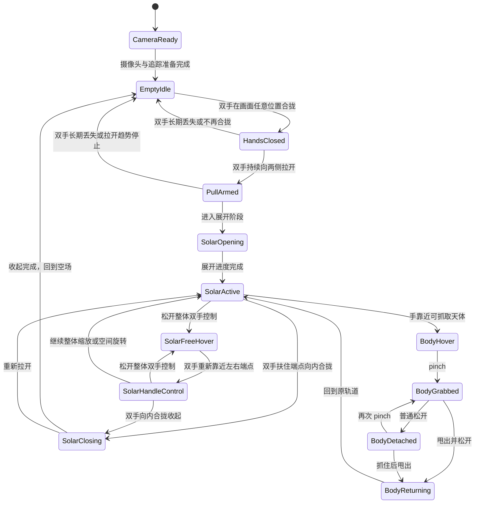
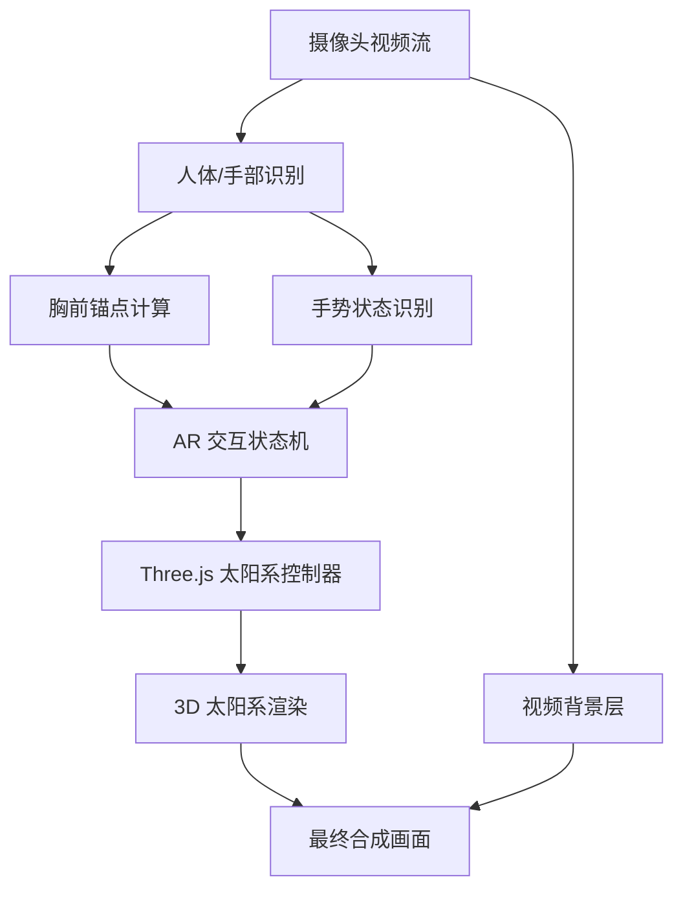

# 摄像头 AR 太阳系手势交互 Demo 产品需求文档

版本：v0.3  
日期：2026-06-21  
阶段：MVP 产品需求设计  
目标形态：可演示的实时摄像头 AR 交互 Demo

## 1. 项目概述

本项目旨在制作一个基于普通摄像头的实时 AR 视觉交互 Demo：用户打开摄像头后，画面中显示用户本人。初始画面没有任何可见 3D 模型，用户需要在摄像头可见画面任意位置将双手合拢或双拳紧靠，然后向两侧拉开，太阳系会随着双手距离被“拉”出来，并逐渐展开为悬浮在胸前附近的 3D 太阳系。

展开过程中，太阳系的左右两端需要像吸附在用户双手上一样跟随手部位置移动。展开完成后，用户可以用双手控制太阳系整体缩放和空间旋转，也可以捏起水星、金星、地球、火星、木星、土星、天王星、海王星以及月球。被捏起的星球会脱离轨道并吸附到手上，可单独缩放、空间旋转和观赏。

松开手势后，被抓取的星球不自动飞回原轨道，而是停留在释放位置并恢复自然运动，例如自转。只有当用户做出明确的甩出动作时，该星球才飞回原轨道并恢复公转。

项目第一阶段不追求真实空间 AR 锚定，而是以普通摄像头画面为背景，通过人体姿态识别、手部关键点识别和 3D 渲染叠加，模拟出“太阳系悬浮在用户胸前并可被双手操控”的视觉效果。

## 2. 一句话定义

一个打开摄像头即可体验的“胸前 AR 太阳系”：初始无 3D 模型，用户双手在画面任意位置合拢后拉开太阳系，并能在空中缩放、空间旋转、捏起星球、悬停观赏和甩回轨道。

## 3. 产品目标

### 3.1 MVP 目标

MVP 需要证明以下体验成立：

1. 摄像头画面中可以实时看到用户本人。
2. 初始画面没有任何可见 3D 太阳系、行星、奇点或星云模型。
3. 用户双手在摄像头可见画面任意位置合拢并向两侧拉开时，太阳系随手部位置被拉出。
4. 拉开过程中，太阳系的左右边界或展开端点需要吸附在双手位置上。
5. 太阳系展开后默认悬浮在用户胸前区域，而不是固定在屏幕中心。
6. 用户双手距离变化可以控制太阳系整体缩放。
7. 用户双手姿态变化可以控制太阳系整体空间旋转，而不是 2D 平面旋转。
8. 用户可以捏起水星、金星、地球、火星、木星、土星、天王星、海王星和月球。
9. 被抓取天体可以吸附在手部位置并跟随手移动。
10. 被抓取天体在捏住时停止自主运动，便于稳定观赏。
11. 被抓取天体可以被单独空间旋转和缩放。
12. 松开后，被抓取天体停留在释放位置，不自动回轨。
13. 松开后，被抓取天体恢复自然运动，例如自转。
14. 用户做出甩出动作后，被抓取天体飞回原轨道并恢复公转。
15. 整个体验可以稳定录制 30-60 秒演示视频。

### 3.2 非目标

MVP 暂不追求：

1. 真正的空间定位 AR。
2. 多人同时交互。
3. 精确物理模拟。
4. 天文学比例完全真实。
5. 行星真实轨道倾角、速度和距离的科学级还原。
6. 手指毫米级精准抓取。
7. 移动端、Vision Pro、Quest 等 XR 设备适配。
8. 商业展厅级稳定性。
9. 复杂天文科普信息系统。
10. 抓取后星球之间的真实碰撞模拟。

## 4. 目标用户与使用场景

### 4.1 目标用户

| 用户类型 | 需求 |
|---|---|
| 创作者/演示者 | 做出一段一眼看懂的炫酷交互视频 |
| 科技课程讲解者 | 用身体和手势讲解太阳系、行星、宇宙尺度 |
| Demo 制作者 | 快速验证 AR 手势交互玩法 |
| 互动视觉爱好者 | 体验摄像头驱动的 3D 空间交互 |

### 4.2 核心使用场景

用户打开网页或桌面应用，允许摄像头权限。画面中只出现用户本人和必要的轻量 UI 提示，不出现任何 3D 太阳系模型。用户将双手或双拳在摄像头可见画面任意位置合拢，然后向左右拉开。系统基于双手相对位置和手部移动方向识别启动手势，不要求双手靠近胸前、肩膀或胸前锚点。识别成功后，在双手之间生成太阳系展开动画：太阳、轨道、星球和星云随双手距离逐渐出现。

展开完成后，太阳系悬浮在用户胸前。用户可以继续通过双手控制太阳系整体缩放和空间旋转，也可以用捏合手势抓取某颗星球或月球。被抓取的天体脱离轨道并吸附在手上，用户可单独查看、放大、缩小和旋转。松开后，该天体停留在空中并自然自转；当用户做出甩出动作后，它带着尾迹飞回原轨道。

## 5. 核心体验原则

### 5.1 第一眼要像 AR

太阳系不能只是放在屏幕中央，而要明显与用户身体位置关联。用户移动身体时，太阳系需要跟随胸前锚点平滑移动。

### 5.2 开始时必须是空场

初始阶段不显示 3D 太阳、星球、轨道、星云或奇点。用户需要通过双手动作把太阳系“召唤”出来。这样开场更有仪式感，也更符合“从双手之间拉开一个太阳系”的核心设想。

允许存在以下非 3D 辅助元素：

1. 摄像头画面。
2. 极轻量的 2D 提示文字。
3. 调试模式下的手部关键点。

不允许存在以下初始元素：

1. 发光奇点。
2. 预先显示的太阳。
3. 预先显示的轨道。
4. 预先显示的星云背景。
5. 任何漂浮的 3D 装饰物。

### 5.3 展开必须跟手

太阳系不是触发后播放一段固定动画，而是要被双手“拉开”。展开宽度、展开进度和视觉张力都应由双手距离驱动。用户手停住，展开也应在对应阶段停住或缓慢保持；用户继续拉开，太阳系继续扩展。

### 5.4 旋转必须是空间旋转

太阳系整体旋转和单个星球旋转都应表现为 3D 空间旋转，而不是图片在屏幕上绕中心点做 2D 旋转。需要能看到轨道平面倾斜、星球朝向变化和视角深度变化。

### 5.5 抓取后是观赏状态，不是立刻回收

被抓取的星球或月球应允许用户拿在手上观察。松开后，它不应自动飞回轨道，而是停留在释放位置，像一个被拿出来展示的模型。只有用户做出甩出动作，系统才将其送回轨道。

## 6. 交互动作与系统反馈

| 动作 | 用户直觉 | 系统反馈 |
|---|---|---|
| 双手在画面任意位置合拢/双拳紧靠 | 准备打开 | 进入双手合拢状态，不播放太阳系动画，也不显示 3D 模型 |
| 双手向两侧拉开 | 从双手之间拉出太阳系 | 太阳系两端吸附双手并随距离展开 |
| 双手从展开两端向内合拢 | 把太阳系收回双手之间 | 太阳系随手距反向缩放并收起，最终回到空场 |
| 双手从太阳系两端松开 | 把物体留在空中 | 太阳系保持在松手前的稳定位置、大小和朝向 |
| 双手重新靠近太阳系两端 | 再次扶住物体 | 进入整体太阳系控制状态，不要求 pinch 某颗星球 |
| 双手距离变大 | 放大 | 太阳系整体放大 |
| 双手距离变小 | 缩小 | 太阳系整体缩小 |
| 掌心朝前并左右推拉 | 推拉玻璃窗式缩放 | 太阳系整体缩放 |
| 掌心朝上并轻轻旋转 | 托住并转动物体 | 太阳系发生 3D 空间旋转 |
| 食指拇指捏合 | 抓取 | 最近天体吸附到手上 |
| 捏住天体不动 | 稳定观赏 | 天体停止自主运动，固定在手上 |
| 双手操作已抓取天体 | 单独查看 | 天体单独缩放和空间旋转 |
| 松开 pinch | 放下 | 天体悬停在当前位置并恢复自转 |
| 甩出动作 | 送回轨道 | 天体带尾迹飞回原轨道并恢复公转 |

## 7. MVP 功能范围

### 7.1 摄像头与真人背景

功能描述：

1. 打开应用后请求摄像头权限。
2. 摄像头画面以完整画面显示，作为 AR 预览背景层。MVP 默认使用 16:9 预览容器承载 16:9 摄像头输入。
3. 支持前置镜像显示，用户看到自己时符合自拍直觉。
4. 摄像头画面上叠加透明 WebGL Canvas，用于后续显示 3D 太阳系和交互特效。
5. 视频、WebGL Canvas 和坐标调试/交互 overlay 必须共享同一显示尺寸，避免手势识别画面和用户看到的画面错位。
6. 摄像头预览使用 `object-fit: contain`，保留完整画面；不得使用 `cover` 将 16:9 摄像头输入裁切成接近 1:1、竖屏或其他非源比例区域。

验收标准：

1. 用户允许权限后，1-3 秒内显示摄像头画面。
2. 摄像头画面不明显拉伸变形，也不因填满页面而被裁切放大。
3. 初始状态无任何可见 3D 模型。
4. 调试面板可显示摄像头原始尺寸、页面显示尺寸、显示比例、`object-fit` 和 Canvas 尺寸，用于校验显示与渲染层对齐。

### 7.2 人体胸前锚点

功能描述：

1. 识别用户左右肩位置。
2. 根据左右肩中心点估算胸前锚点。
3. 太阳系展开完成后悬浮在胸前锚点附近。
4. 当用户身体轻微移动时，太阳系跟随胸前锚点移动。

胸前锚点估算方式：

```text
chestX = (leftShoulder.x + rightShoulder.x) / 2
chestY = (leftShoulder.y + rightShoulder.y) / 2 + shoulderDistance * 0.35
chestZ = 视觉模拟深度，不作为真实空间深度
```

验收标准：

1. 用户站在摄像头前时，展开后的太阳系出现在胸口附近。
2. 用户左右移动时，太阳系不会固定在屏幕中心。
3. 肩膀短暂丢失时，太阳系保持上一稳定位置，不突然消失。

### 7.3 初始状态：空场

功能描述：

1. 初始状态只显示摄像头画面。
2. 不显示奇点、轨道、太阳、星球、星云或粒子。
3. 可用极简 2D 提示引导用户双手或双拳在摄像头可见画面任意位置合拢，再向两侧拉开。
4. 系统持续检测双手是否在画面内合拢；该启动检测不得要求双手靠近胸前、肩膀或胸前锚点。

验收标准：

1. 打开摄像头后，画面中没有任何 3D 太阳系元素。
2. 用户不做动作时，系统不会自动出现太阳系。
3. 用户能通过轻量提示理解需要双手先合拢再拉开。

### 7.4 双手吸附拉开太阳系

功能描述：

1. 系统识别左右手掌、手腕或手部中心点。
2. 当双手在摄像头可见画面任意位置合拢并向两侧拉开时，太阳系进入 opening 状态。
3. opening 状态下，太阳系的左右展开端点绑定到左右手位置。
4. 双手距离决定太阳系展开进度。
5. 双手在拉开过程中停住，展开进度也应相对停住，而不是继续自动播完。
6. 双手继续拉开，太阳系继续从中心向两端扩展。
7. 双手/双拳保持合拢但没有拉开时，不显示太阳系，也不播放任何 3D 动画。
8. 展开完成或用户松开整体双手控制后，太阳系保持在松手前的最后稳定位置、缩放和朝向，不自动回到屏幕中心，也不突然吸回胸前锚点。
9. 当太阳系已经展开且双手扶住左右端点时，双手从拉开状态向内合拢应驱动反向收起动画；收起进度同样由手距驱动。
10. 反向收起完成后，太阳系 3D 内容全部隐藏，画面回到启动前的空场状态。

视觉表现建议：

1. 双手刚开始分离时，先出现一条短促的发光空间裂缝或轨道骨架。
2. 随双手距离增大，太阳从双手之间的中点附近显现。
3. 行星轨道由内到外被拉开。
4. 行星在对应轨道上逐个显现。
5. 星尘和星云随展开进度从中心扩散出来。
6. 反向收起时，太阳、轨道、行星、星尘和星云按展开逻辑反向消失。

触发规则建议：

```text
条件 1：检测到左右手
条件 2：双手初始距离小于画面归一化宽度/对角线的近距阈值，或双拳/双手明显紧靠
条件 3：启动检测只使用双手相对位置和运动趋势，不使用胸前锚点、肩膀或身体姿态作为必要条件
条件 4：双手距离在 0.2-1.5 秒内持续增大
条件 5：最终双手距离相对初始手距达到足够增量
条件 6：双手/双拳重叠导致一只手短时间丢失时，可以锁存最近一次有效的双手合拢证据；但不能在没有近期双手证据的情况下用单手启动
```

展开进度建议：

```text
openProgress = clamp(
  (currentHandDistance - startHandDistance) /
  (targetHandDistance - startHandDistance),
  0,
  1
)
```

反向收起建议：

```text
closeProgress = 1 - openProgress
```

说明：无论展开还是收起，视觉进度都应跟随当前手距；双手停住时，展开/收起都应停住或保持，不应自动完成。

验收标准：

1. 用户做出明显“双手先合拢再拉开”动作时，80% 以上可成功触发，无论双手位于胸前、头顶、身体侧边或画面内其他可见位置。
2. 展开过程能明显看出太阳系两端跟随双手位置。
3. 用户拉得快，太阳系展开更快；用户拉得慢，太阳系展开更慢。
4. 触发失败时，不应出现乱闪或误爆发。
5. 双手只保持紧握不拉开时，不出现任何太阳系动画或 3D 内容。
6. 用户松开整体双手控制后，太阳系悬浮停留在松手前的位置、大小和朝向。
7. 用户重新扶住左右端点并向内合拢双手时，太阳系随手距反向收起。
8. 反向收起完成后，太阳系消失，画面回到只显示摄像头和 2D UI 的空场。

### 7.4.1 整体太阳系松手与重新扶住

功能描述：

1. 太阳系展开后，系统需要判断用户是否仍在“扶住”太阳系两端。
2. 松手的主要判断来自手型：双手五指明显张开、手指伸展、grip-pose 分数降低后，系统应立即冻结端点并进入松手候选。
3. 张开手松手一旦被接受，需要锁存释放意图：即使用户慢慢收回手、手指在收回过程中自然弯曲，也不能重新把端点粘回手上。
4. 整体释放不是关闭太阳系，而是让太阳系悬浮在松手前的最后稳定 transform 上。
5. 用户再次把双手靠近太阳系左右端点时，系统可以重新进入整体控制状态。
6. 重新扶住整体太阳系不要求 pinch，因为 pinch 主要用于后续抓取单个天体。
7. 张开手释放后，重新扶住必须等双手先明确离开冻结端点，再重新靠近冻结端点；不能在用户慢慢撤手时自动重新扶住。
8. 整体控制需要使用迟滞和保持窗口，避免端点附近反复进出控制状态。
9. 重新扶住后，如果双手向内合拢并接近闭合阈值，系统应进入整体收起状态，而不是把这个动作误判为单纯缩小或抓取单个天体。
10. 双手微弯、像握住两侧把手时，应保持整体控制并继续让端点跟手；不能把轻微弯曲误判为松手。
11. 双手完全丢失、端点明显不匹配或整体控制置信度过低可以作为兜底松手信号，但不应取代张开手这一主要松手手势。

验收标准：

1. 用户松开双手后，太阳系不会消失、不会回到屏幕中心，也不会突然重置到胸前锚点。
2. 用户重新把双手放到太阳系两侧端点附近后，可以继续控制整体太阳系。
3. 整体控制和单个行星 pinch 抓取不会互相误触发。
4. 双手从左右端点向内合拢可以触发整体收起，并最终回到空场。

### 7.4.2 接入 3D 前的整体交互协议层

功能描述：

1. 在 MediaPipe 手部关键点和未来 Three.js 太阳系控制器之间，需要有一层明确的整体交互协议。
2. 协议层输入手部中心、手距、手距速度、双手方向向量、掌心朝向基础量、张开手/握持手型分数、pinch 倾向和虚拟端点位置。
3. 协议层输出整体控制状态、控制置信度、松手置信度、重新扶住置信度、缩放意图、旋转意图、反向收起意图、张开手松手手势和已接受释放锁状态。
4. 该协议层不得直接渲染太阳、行星、轨道、星云、粒子、奇点或任何 3D 模型。
5. 在接入可见 3D 太阳系之前，可以只在 debug 面板中显示协议输出，并在 debug overlay 中显示 2D 虚拟端点。
6. 虚拟端点表示未来太阳系视觉左/视觉右把手的位置：整体控制时随双手更新；进入松手候选或自由悬浮后冻结在最后稳定位置；重新扶住时用于判断双手是否回到视觉左右端点附近。
7. 整体控制状态至少包括 `Inactive`、`VirtualOpeningHandle`、`SolarHandleControl`、`ReleaseCandidate`、`SolarFreeHover`、`ReGripCandidate` 和 `SolarClosing`。
8. 掌心朝向只作为意图置信度加分，不作为硬性门槛；普通摄像头下掌心法线不应被当作精确 3D 传感器使用。
9. 整体控制意图需要与单个行星 pinch 抓取意图区分；强 pinch 倾向应降低整体控制置信度，而不是增强整体控制。
10. 视觉左/视觉右端点以用户看到的镜像画面为准，不等同于 MediaPipe handedness 的 left/right。

验收标准：

1. Debug 面板能显示整体控制状态和控制/松手/重新扶住置信度，并明确区分 `Startup state` 与 `Whole control`。
2. Debug 面板能显示缩放、旋转和反向收起意图。
3. Debug 面板能显示左右掌心法线、掌心朝向摄像头分数和掌心朝上分数。
4. Debug 面板能显示视觉左/视觉右虚拟端点以及端点是否匹配。
5. Debug 面板能显示左右手 open-hand 分数、grip-pose 分数、伸展手指数、松手手势是否激活以及释放锁是否开启。
6. Debug overlay 只在 debug 模式下显示 2D 虚拟端点，不显示任何 3D 太阳系内容。
7. 真实摄像头验证后，若端点半径、掌心分数、张开手阈值或意图阈值不稳定，应先调试该协议层，再进入 Milestone 4。

### 7.5 太阳系整体缩放

功能描述：

1. 展开完成后，双手距离控制太阳系整体缩放。
2. 两手距离变大，太阳系放大。
3. 两手距离变小，太阳系缩小。
4. 缩放需要有平滑阻尼，避免画面抖动。
5. 当用户双手重新扶住太阳系两侧端点时，双手距离变化继续控制整体缩放。
6. 当用户掌心朝前，并像左右推拉玻璃窗一样移动双手时，也应被理解为整体缩放手势。
7. 缩放控制应优先使用双手距离变化；掌心朝前可作为提高缩放意图置信度的信号。

参数建议：

| 参数 | 建议值 |
|---|---:|
| 最小缩放 | 0.6x |
| 默认缩放 | 1.0x |
| 最大缩放 | 2.5x |
| 平滑系数 | 0.12-0.25 |

验收标准：

1. 双手拉远时太阳系明显变大。
2. 双手靠近时太阳系明显变小。
3. 缩放过程没有明显跳变。
4. 松手后再次扶住两侧端点，仍然可以继续缩放。
5. 掌心朝前左右推拉时，系统能稳定理解为缩放而不是抓取单个天体。

### 7.6 太阳系整体空间旋转

功能描述：

1. 双手形成一个空间控制柄。
2. 双手左右关系、上下关系和模拟深度变化共同控制太阳系 3D 姿态。
3. 太阳系应支持绕 X/Y/Z 三个轴的组合旋转。
4. 旋转实现建议使用 quaternion 或虚拟轨迹球，避免欧拉角导致的突变。
5. 不把旋转简化成屏幕平面内的 2D 转盘旋转。
6. 当用户掌心朝上并轻轻旋转双手时，系统应理解为整体太阳系空间旋转。
7. 旋转应基于双手控制向量、掌心朝向、掌心法线变化、手腕/手掌 roll 或等价的 3D 姿态估计，而不是只看屏幕平面角度。

普通摄像头下的深度估算可使用：

1. MediaPipe world landmarks 的相对 Z 值。
2. 手掌可见尺寸变化。
3. 双手上下和左右关系形成的 2D 姿态。
4. 预设交互映射，而非真实三维重建。

验收标准：

1. 用户像托着一个空间物体一样扭动双手时，太阳系产生 3D 倾斜和转向。
2. 能明显看到轨道平面发生空间倾斜，而不只是画面平面旋转。
3. 旋转过程中行星轨道保持可读，不应快速失控。
4. 掌心朝上轻轻旋转时，太阳系能跟随产生稳定、可控的 3D 转动。

### 7.7 可抓取天体列表

MVP 可抓取对象包括：

| 编号 | 天体 | 抓取要求 |
|---|---|---|
| P1 | 水星 | 支持 hover、pinch 抓取、悬停、甩回 |
| P2 | 金星 | 支持 hover、pinch 抓取、悬停、甩回 |
| P3 | 地球 | 支持 hover、pinch 抓取、悬停、甩回 |
| P4 | 火星 | 支持 hover、pinch 抓取、悬停、甩回 |
| P5 | 木星 | 支持 hover、pinch 抓取、悬停、甩回 |
| P6 | 土星 | 支持 hover、pinch 抓取、悬停、甩回，保留土星环 |
| P7 | 天王星 | 支持 hover、pinch 抓取、悬停、甩回 |
| P8 | 海王星 | 支持 hover、pinch 抓取、悬停、甩回 |
| M1 | 月球 | 支持 hover、pinch 抓取、悬停、甩回，默认围绕地球运动 |

说明：

1. MVP 允许九个天体使用简化纹理和非真实比例。
2. 土星需要保留明显的环，避免识别度不足。
3. 月球默认作为地球的子对象运动，被抓取后可从地月系统中脱离。
4. 同一时间只允许抓取一个天体，降低交互冲突。

验收标准：

1. 九个天体都可以被高亮和抓取。
2. 抓取不同天体时，标签名称准确。
3. 月球可与地球区分，不被地球交互热区完全覆盖。

### 7.8 星球选择与高亮

功能描述：

1. 当手部靠近某个可抓取天体的屏幕投影位置时，该天体进入 hover 状态。
2. hover 状态表现为星球外圈光晕、名称标签和轨道线轻微变亮。
3. 当多个天体接近手部时，优先选择屏幕距离最近且热区权重最高的天体。
4. 为小天体扩大交互热区，避免水星、月球过难抓取。

验收标准：

1. 用户手靠近目标天体时，目标天体明显高亮。
2. 高亮不会在多个天体之间疯狂跳动。
3. 选中反馈足够明显，录屏可看清。

### 7.9 捏合抓取天体

功能描述：

1. 使用拇指和食指距离判断 pinch 手势。
2. 当 pinch 发生且手部靠近可抓取天体时，该天体进入 grabbed 状态。
3. 天体从轨道位置吸附到手部位置。
4. 被抓取后，天体跟随手部移动。
5. 被抓取天体脱离原有公转系统，原轨道位置可显示半透明占位光点。

pinch 判断建议：

```text
pinchDistance = distance(thumbTip, indexFingerTip)
pinchStart = pinchDistance < handScale * 0.18
pinchEnd = pinchDistance > handScale * 0.28
```

说明：开始和结束阈值应使用不同数值，避免手势在临界点反复闪烁。

验收标准：

1. 用户捏合时，可抓起当前高亮天体。
2. 抓取成功时有吸附动画。
3. 捏住移动时，天体跟随手移动。
4. 短暂识别丢失时，天体不立刻掉落。

### 7.10 抓取后的单体观赏、缩放与空间旋转

功能描述：

1. 天体被捏住时，停止自主自转和公转。
2. 天体被捏住时，位置绑定到手部锚点，不应自行漂移。
3. 用户可以通过另一只手辅助，对被抓取天体进行单独缩放。
4. 用户可以通过双手相对运动，对被抓取天体进行单独空间旋转。
5. 单体旋转必须是 3D 空间旋转，而不是 2D 贴图转动。

建议交互：

| 操作 | 效果 |
|---|---|
| 单手 pinch 抓住 | 天体固定到手上，停止自主运动 |
| 抓住后移动手 | 天体跟随移动 |
| 另一只手靠近并拉开 | 放大被抓取天体 |
| 另一只手靠近并合拢 | 缩小被抓取天体 |
| 双手相对扭动 | 3D 旋转被抓取天体 |

验收标准：

1. 捏住不动时，被抓取天体稳定停在手上。
2. 被抓取天体不会继续自转，便于观赏表面。
3. 单体缩放和旋转不影响整个太阳系。
4. 空间旋转能看出天体朝向变化。

### 7.11 松开后悬停与自然运动

功能描述：

1. 用户松开 pinch 后，天体不自动飞回原轨道。
2. 天体停留在释放位置，进入 detached 状态。
3. detached 状态下，天体恢复自然自转。
4. detached 状态下，天体不参与原轨道公转。
5. 原轨道位置可保留一个弱光占位点或半透明影子，提示其来源。

验收标准：

1. 松开后，天体留在当前空中位置。
2. 松开后，天体自然自转，而不是完全静止。
3. 用户可以再次捏住该天体继续移动或查看。
4. 太阳系其他天体继续正常运动。

### 7.12 甩出回轨

功能描述：

1. 当用户抓住 detached 天体并做出甩出动作时，天体进入 returning 状态。
2. 甩出动作通过手部速度、方向和松开时机判断。
3. returning 状态下，天体带尾迹飞回原轨道位置。
4. 回轨后，天体恢复原始尺寸、轨道层级和公转。

甩出识别建议：

```text
throwVelocity = handVelocityAtRelease
throwStart = isPinching && handVelocity > velocityThreshold
throwConfirm = pinchEnd within 0.2s after throwStart
```

容错策略：

1. 如果速度不足，只进入 detached 悬停，不回轨。
2. 如果方向接近原轨道方向，增强回轨命中率。
3. 对小天体放宽甩出阈值，避免月球过难操作。

验收标准：

1. 普通松开不会回轨。
2. 明显甩出动作会触发回轨。
3. 回轨动画流畅，有尾迹或光线反馈。
4. 回轨后天体恢复公转。

## 8. 视觉设计需求

### 8.1 整体风格

关键词：

1. 科幻。
2. 宇宙。
3. 真实 3D。
4. 发光轨道。
5. 手势魔法感。
6. AR 悬浮。
7. 空间感。
8. 仪式感开场。

### 8.2 太阳系视觉组成

| 元素 | MVP 要求 |
|---|---|
| 太阳 | 中心发光球体，带光晕 |
| 水星 | 小型灰色岩质星球 |
| 金星 | 黄白色云层质感 |
| 地球 | 蓝绿色纹理，带月球系统 |
| 月球 | 小型灰白球体，默认绕地球运动 |
| 火星 | 红褐色岩质星球 |
| 木星 | 大体积条纹气态行星 |
| 土星 | 带明显土星环 |
| 天王星 | 青蓝色、轴向可略倾斜 |
| 海王星 | 深蓝色气态行星 |
| 轨道 | 半透明发光圆环 |
| 星云 | 展开后出现的动态背景层 |
| 星尘 | 拉开过程中从双手中点向外扩散 |
| 标签 | hover 或 grabbed 时显示天体名称 |

### 8.3 动画需求

| 动画 | 描述 |
|---|---|
| 空场待机 | 初始只显示真人摄像头画面 |
| 双手拉开 | 太阳系两端吸附双手并展开 |
| 行星公转 | 展开后行星围绕太阳缓慢运动 |
| 自转 | 未抓取或松开后的天体自然自转 |
| 抓取吸附 | 天体飞向手部 |
| 抓取冻结 | 捏住时停止自主运动 |
| 悬停自转 | 松开后停留在空中并恢复自转 |
| 甩出回轨 | 天体带尾迹返回原轨道 |
| 手部反馈 | 手靠近对象时出现小型光圈或粒子 |

## 9. 交互状态机



## 10. 技术方案建议

### 10.1 推荐 MVP 技术栈

| 模块 | 推荐方案 |
|---|---|
| 摄像头输入 | Browser MediaDevices API |
| 手部识别 | MediaPipe Hand Landmarker / Gesture Recognizer |
| 人体姿态识别 | MediaPipe Pose Landmarker |
| 3D 渲染 | Three.js |
| 前端框架 | 原生 JS 或 React |
| 动画补间 | GSAP 或 Three.js 内置插值 |
| 姿态旋转 | Quaternion / Arcball 映射 |
| Demo 形态 | Web 页面优先，后续可封装 Electron |

选择理由：

1. 普通摄像头即可体验。
2. 浏览器运行，演示门槛低。
3. Codex 可直接辅助开发、调试和迭代。
4. Three.js 更适合先做 3D 交互逻辑。
5. 后续可迁移到 TouchDesigner、Unity 或 Unreal。

### 10.2 可选升级技术栈

| 目标 | 升级方向 |
|---|---|
| 更稳定手势 | Ultraleap / 深度摄像头 |
| 更强交互产品化 | Unity |
| 更强实时视觉装置 | TouchDesigner |
| 更真实影视级画面 | Unreal Engine |
| 真空间 AR | Vision Pro / Quest / AR 眼镜 |

## 11. 系统架构



## 12. 数据与坐标映射

### 12.1 输入数据

| 数据 | 来源 | 用途 |
|---|---|---|
| 左右肩关键点 | Pose | 计算展开后的胸前视觉锚点，不参与启动手势必要条件 |
| 左右手腕 | Hand/Pose | 判断双手距离 |
| 手掌中心 | Hand | 展开端点、星球吸附位置 |
| 食指指尖 | Hand | 判断指向和抓取位置 |
| 拇指指尖 | Hand | 判断 pinch |
| 左右手距离 | Hand | 拉开展开、缩放太阳系 |
| 双手相对姿态 | Hand | 空间旋转太阳系 |
| 手部速度 | Hand | 判断甩出动作 |
| 手掌尺寸 | Hand | 辅助估算深度和 pinch 阈值 |
| 手掌朝向 / palm normal | Hand | 判断掌心朝前缩放、掌心朝上旋转和整体控制意图 |
| 左右展开端点 | Solar System Controller | 判断整体太阳系是否被重新扶住 |
| 整体太阳系 transform | Solar System Controller | 松手后保持悬浮位置、缩放和朝向 |

### 12.2 2D 到 3D 映射原则

MVP 中不做真实空间深度重建，而是将手部和胸前锚点从摄像头画面坐标映射到 Three.js 的 3D 场景平面，并使用相对 Z 值、手掌大小和运动规则模拟空间深度。启动手势阶段只依赖双手坐标；胸前锚点只用于后续视觉放置和身体相对 AR 感。

```text
cameraX/Y: 0-1 归一化坐标
threeX = (cameraX - 0.5) * sceneWidth
threeY = -(cameraY - 0.5) * sceneHeight
threeZ = estimatedDepth or interactionPresetDepth
```

### 12.3 空间旋转映射原则

整体太阳系和单体天体都应使用 3D 姿态控制：

```text
leftHand3D = mapHandToScene(leftHand)
rightHand3D = mapHandToScene(rightHand)
controlVector = rightHand3D - leftHand3D
targetRotation = quaternionFromControlVector(controlVector, previousControlVector)
object.quaternion.slerp(targetRotation, smoothing)
```

目标不是科学级空间追踪，而是让观众看到明确的 3D 倾斜、转向和深度变化。

补充规则：

1. 掌心朝上可以提高“整体旋转”意图置信度。
2. 掌心朝前并左右移动可以提高“整体缩放”意图置信度。
3. 整体控制意图需要与 pinch 抓取意图区分；整体控制不应要求拇指和食指捏合。

### 12.4 平滑策略

所有识别坐标都需要做平滑处理：

1. 胸前锚点：低通滤波，用于后续视觉放置，不作为启动手势必要条件。
2. 手部位置：低通滤波 + 丢帧保持；启动阶段允许短时间锁存最近一次有效双手合拢证据，以容忍双手/双拳贴近造成的一只手遮挡。
3. 展开进度：跟随手距，但限制最大变化速度。
4. 缩放值：限制最大变化速度。
5. 旋转值：使用 quaternion slerp 追赶目标姿态。
6. pinch 状态：使用迟滞阈值。
7. 甩出速度：使用短时间窗口均值，避免单帧误判。

## 13. 关键参数建议

| 参数 | 建议值 | 说明 |
|---|---:|---|
| 双手合拢距离阈值 | 归一化画面距离约 0.15-0.20 | 启动手势合拢判定，需实测 |
| 拉开触发增量 | 相对合拢起始手距增加约 0.08-0.15 | 从 `HandsClosed` 进入 `PullArmed`，需实测 |
| 展开完成距离 | 基于起始手距的相对增量 | 太阳系完全展开，后续实测 |
| 展开进度平滑 | 0.15-0.3 | 防止手部抖动 |
| 星球抓取吸附时长 | 0.25-0.45s | 需要有“吸过去”的感觉 |
| 悬停自转延迟 | 0.1-0.3s | 松开后自然恢复 |
| 甩出速度阈值 | 需实测 | 基于摄像头画面比例 |
| 回轨动画时长 | 0.8-1.5s | 需要优雅回归 |
| 摄像头帧率目标 | 30fps | MVP 基础要求 |
| 3D 渲染帧率目标 | 30-60fps | 低于 30fps 体验明显下降 |
| 胸前锚点丢失保持 | 1s | 防止短暂识别失败 |
| 手部丢失保持 | 2s 左右 | 防止启动合拢、拉开或抓取时因短时间遮挡闪断 |
| pinch 开始阈值 | 手掌尺度 * 0.18 | 需实测调整 |
| pinch 结束阈值 | 手掌尺度 * 0.28 | 避免频繁开关 |

## 14. MVP 页面与操作流程

### 14.1 页面结构

1. 启动页：
   - 标题：AR Solar System
   - 按钮：开启摄像头
   - 简短提示：让双手保持在画面中清晰可见，双手合拢后再向两侧拉开

2. 交互页：
   - 完整 16:9 摄像头预览背景
   - 初始无 3D 模型
   - 拉开后显示胸前 AR 太阳系
   - 右上角状态提示
   - 左下角调试面板，可开关

3. 调试面板：
   - 当前 FPS
   - 是否识别到身体
   - 是否识别到左右手
   - 当前状态
   - openProgress
   - 整体控制状态、控制置信度、松手置信度、重新扶住置信度
   - 缩放意图、旋转意图和反向收起意图
   - 左右掌心法线、掌心朝向摄像头分数、掌心朝上分数
   - 双手 open-hand 分数、grip-pose 分数、伸展手指数和松手手势
   - 视觉左/视觉右虚拟端点和端点匹配状态
   - pinch 状态
   - 当前抓取天体
   - 缩放值
   - 甩出速度
   - 摄像头原始尺寸、页面显示尺寸、显示比例、`object-fit` 和 Canvas 尺寸

### 14.2 用户流程

1. 用户打开页面。
2. 点击“开启摄像头”。
3. 用户站到画面中央。
4. 画面只显示摄像头真人画面。
5. 用户双手或双拳在摄像头可见画面任意位置合拢。
6. 用户双手向两侧拉开。
7. 太阳系的展开端点吸附双手，并随双手距离展开。
8. 展开完成后，太阳系悬浮于胸前。
9. 用户用双手缩放、空间旋转太阳系。
10. 用户用手靠近任意可抓取天体，天体高亮。
11. 用户捏合手指，目标天体吸附到手上。
12. 用户捏住天体不动，天体停止自主运动，便于观赏。
13. 用户对被抓取天体进行单独缩放和空间旋转。
14. 用户普通松开，天体悬停在释放位置并自然自转。
15. 用户再次抓住该天体并甩出，天体飞回原轨道。

## 15. 验收标准

### 15.1 基础验收

| 编号 | 验收项 | 标准 |
|---|---|---|
| A1 | 摄像头启动 | 能正常打开并显示真人画面 |
| A2 | 初始空场 | 打开后无任何可见 3D 模型 |
| A3 | 胸前定位 | 展开后的太阳系出现在胸口附近 |
| A4 | 吸附拉开 | 双手在画面任意位置合拢后拉开时，太阳系两端跟随双手展开 |
| A5 | 缩放 | 双手距离变化可控制太阳系大小 |
| A6 | 空间旋转 | 双手姿态变化可控制太阳系 3D 姿态 |
| A7 | 天体高亮 | 手靠近任意可抓取天体时，该天体高亮 |
| A8 | 天体抓取 | 九个目标天体均可 pinch 抓取 |
| A9 | 抓取冻结 | 捏住时天体停止自主运动 |
| A10 | 单体操作 | 被抓取天体可单独缩放和空间旋转 |
| A11 | 松开悬停 | 普通松开后天体不回轨，停留在释放位置 |
| A12 | 自然运动 | 松开后天体恢复自转 |
| A13 | 甩出回轨 | 明显甩出动作触发天体回轨 |
| A14 | 录屏 | 可完成 30-60 秒连续演示 |

### 15.2 体验验收

1. 第一次观看的人能理解“太阳系是从用户双手之间被拉出来的”。
2. 展开过程中能看出太阳系两端吸附在双手上。
3. 第一次观看的人能理解“太阳系在用户胸前”。
4. 旋转有明显空间感，不像普通 2D 转盘。
5. 抓取任意星球都有明确反馈。
6. 松开后星球停在空中这一点足够明确，不被误解为失败。
7. 甩出回轨动作有明显尾迹和回归反馈。
8. 演示过程中不需要频繁解释才能看懂。

## 16. 风险与应对

| 风险 | 影响 | 应对 |
|---|---|---|
| 普通摄像头没有真实深度 | 空间旋转和吸附不够真实 | 使用相对 Z、手掌尺寸、光效和缩放模拟 |
| 初始空场缺少提示 | 用户不知道怎么开始 | 使用极简 2D 提示，不显示 3D 模型 |
| 双手拉开误触发 | 体验混乱 | 使用双手合拢稳定时间、近距阈值、连续拉开趋势和丢手保持 |
| 拉开跟手难以稳定 | 展开动画抖动 | 展开进度平滑，端点吸附用阻尼跟随 |
| 九个天体都可抓导致难度上升 | 开发量增加 | 统一抓取接口，纹理和尺寸先简化 |
| 小天体太难抓 | 抓取失败率高 | 扩大水星和月球交互热区 |
| 松开不回轨易被误解 | 用户以为星球丢了 | 显示原轨道占位点和“悬停观赏”状态反馈 |
| 甩出误判 | 普通松开也回轨 | 使用速度阈值 + 松开时间窗 + 方向判断 |
| 摄像头画面与 3D 对不上 | AR 感下降 | 镜像、坐标映射、胸前锚点反复校准 |
| 性能不足 | 卡顿 | 限制粒子数量、降低阴影和后处理 |

## 17. 开发里程碑

### Milestone 1：基础摄像头与 3D 叠加

目标：

1. 打开摄像头。
2. Three.js 场景叠加在视频层上。
3. 初始状态不显示任何 3D 模型。

交付物：

1. 可运行网页 Demo。
2. 完整显示且不裁切的 16:9 摄像头预览背景。
3. 与摄像头预览尺寸一致的透明 WebGL Canvas。

### Milestone 2：姿态与双手追踪基础

目标：

1. 接入人体姿态识别。
2. 接入双手识别。
3. 暴露稳定的肩部和双手关键点数据。

交付物：

1. 姿态和左右手检测状态。
2. 手部中心、拇指、食指、手腕、手掌尺度等调试数据。

### Milestone 3：纯双手合拢到拉开预备状态

目标：

1. 在空场状态下检测双手是否在画面任意位置合拢。
2. 识别双手从合拢状态持续向两侧拉开。
3. 进入 `HandsClosed` 和 `PullArmed` 状态。
4. 不使用胸前锚点、肩膀或身体姿态作为启动手势必要条件。

交付物：

1. 纯双手启动状态机和调试指标。
2. 初始场景仍保持无任何 3D 内容。

### Milestone 3.5：接入 3D 前的整体交互协议

目标：

1. 在不渲染太阳系 3D 内容的前提下，实现整体太阳系控制协议。
2. 计算掌心朝向基础量和整体控制意图分数。
3. 调试松手、自由悬浮、重新扶住、缩放、3D 旋转和反向收起意图。
4. 使用 debug 面板和 debug-only 2D 虚拟端点验证协议是否稳定。

交付物：

1. `WholeSystemIntent` 调试输出。
2. 整体控制状态和控制/松手/重新扶住置信度。
3. 缩放、旋转和反向收起意图读数。
4. 掌心法线、掌心朝向摄像头分数、掌心朝上分数。
5. 虚拟左右端点和端点匹配状态。
6. 初始场景和本里程碑验证过程仍保持无任何 3D 太阳系内容。

### Milestone 4：双手吸附拉开展开太阳系

目标：

1. 从 `PullArmed` 状态进入 `SolarOpening`。
2. 实现由手距驱动的太阳系展开。
3. 展开端点吸附双手。
4. 展开完成后将太阳系放置到胸前视觉锚点附近。

交付物：

1. 从空场到太阳系的完整拉开展开效果。

### Milestone 5：整体缩放与空间旋转

目标：

1. 双手距离控制太阳系缩放。
2. 双手姿态控制太阳系 3D 空间旋转。
3. 使用 quaternion 或 arcball 映射减少突变。

交付物：

1. 可用双手操控整体太阳系。

### Milestone 6：九个天体抓取

目标：

1. 建立可抓取天体列表。
2. 实现统一 hover、高亮、pinch 抓取接口。
3. 支持水星、金星、地球、火星、木星、土星、天王星、海王星和月球。

交付物：

1. 九个天体均可被选中和抓起。

### Milestone 7：单体观赏、悬停与甩回

目标：

1. 抓取后冻结自主运动。
2. 支持单体缩放和空间旋转。
3. 普通松开后悬停并自转。
4. 甩出动作触发回轨。

交付物：

1. 完整星球抓取、观赏、释放、甩回闭环。

### Milestone 8：视觉打磨与录屏模式

目标：

1. 增强星云、粒子、光效和尾迹。
2. 优化平滑与容错。
3. 增加隐藏调试 UI 的录屏模式。

交付物：

1. 可录制发布的 30-60 秒演示版本。

## 18. 后续增强方向

### 18.1 交互增强

1. 抓起星球后显示星球信息面板。
2. 支持双手展开星球剖面。
3. 支持手掌托起整个太阳系。
4. 支持多个天体同时悬停展示。
5. 支持一键召回所有脱离轨道的天体。

### 18.2 视觉增强

1. 更真实的行星贴图。
2. 太阳耀斑和体积光。
3. 更复杂的星云背景。
4. 空间粒子拖尾。
5. 手部周围能量场。
6. 被抓取天体表面细节增强。

### 18.3 产品化增强

1. Electron 桌面版。
2. 录屏导出。
3. 预设主题切换。
4. 教学讲解模式。
5. 展厅大屏模式。

## 19. 第一版推荐开发策略

第一版高光闭环应改为：

```text
摄像头打开
→ 初始空场，无任何 3D 模型
→ 用户双手或双拳在画面任意位置合拢
→ 用户双手向两侧拉开
→ 太阳系两端吸附双手并展开
→ 太阳系悬浮在胸前
→ 双手缩放和空间旋转太阳系
→ 捏起任意目标天体
→ 天体吸附在手上并冻结自主运动
→ 单独缩放和空间旋转天体
→ 普通松开后天体悬停并自转
→ 甩出动作让天体飞回原轨道
```

该闭环成立后，再扩展更精细的天体纹理、科普信息面板和更复杂视觉。

## 20. Codex 开发提示词建议

开发时可将任务拆给 Codex，而不是一次性要求它完成全部项目。

### 20.1 第一条任务

```text
创建一个基于 Three.js 的网页 Demo。页面以 16:9 预览容器完整显示摄像头视频作为背景，不裁切画面；在视频上方叠加一个同尺寸透明 WebGL Canvas。初始状态不要渲染任何 3D 模型，只保留摄像头画面和一个可隐藏的调试面板。要求可以本地运行，并提供启动命令。
```

### 20.2 第二条任务

```text
接入 MediaPipe Pose，识别左右肩位置，为后续胸前视觉锚点提供数据。接入 MediaPipe Hands，识别左右手手掌中心、拇指、食指、手腕和手掌尺度，并在调试面板中显示姿态与双手检测状态。
```

### 20.3 第三条任务

```text
实现纯双手启动状态：双手在摄像头可见画面任意位置合拢进入 HandsClosed，随后持续向两侧拉开进入 PullArmed。注意该检测不得依赖胸前锚点、肩膀或身体姿态，且初始状态不能显示奇点或任何 3D 模型。
```

### 20.4 第四条任务

```text
实现双手从 PullArmed 状态进入太阳系展开。展开进度由左右手距离控制，太阳系左右展开端点需要吸附在左右手位置上。用户手停住时，展开进度也应保持，不要自动播完整段动画。
```

### 20.5 第五条任务

```text
实现太阳系整体交互：双手距离控制整体缩放，双手相对姿态控制太阳系 3D 空间旋转。旋转需要表现为轨道平面在 3D 空间中倾斜和转向，不要只做屏幕平面内的 2D 旋转。建议使用 quaternion 或 arcball 映射，并加入平滑处理。
```

### 20.6 第六条任务

```text
建立可抓取天体列表：水星、金星、地球、火星、木星、土星、天王星、海王星和月球。实现统一 hover、高亮、pinch 抓取逻辑。用户手靠近天体时显示标签和光晕，pinch 后天体从轨道吸附到手上。
```

### 20.7 第七条任务

```text
实现被抓取天体的单体观赏逻辑：捏住时天体停止自主自转和公转，稳定吸附在手部位置；允许通过双手对该天体进行单独缩放和 3D 空间旋转；普通松开后天体停留在释放位置并恢复自转，不自动回轨。
```

### 20.8 第八条任务

```text
实现甩出回轨逻辑：当用户抓住一个脱离轨道的天体并做出明显甩出动作后，松开 pinch 时该天体带尾迹飞回原轨道。普通松开不能触发回轨。回轨后恢复原始尺寸、轨道层级和公转。
```

## 21. 总结

本项目的关键不是完整还原太阳系，而是做出一个“用户身体前方真实出现可交互 3D 宇宙”的感受。v0.3 的核心体验已经从“必须在胸前合拢启动”调整为“初始空场，用户双手在画面任意位置合拢并拉开，把太阳系从双手之间拉出来”。同时，星球抓取不再是简单的抓起再松手回轨，而是升级为“抓取、冻结、单体观赏、松开悬停、自转、甩回轨道”的完整交互闭环。

只要空场拉开、双手吸附、空间旋转、九个天体抓取、松开悬停和甩出回轨这几个动作成立，Demo 的传播感和继续开发价值就会非常明确。
