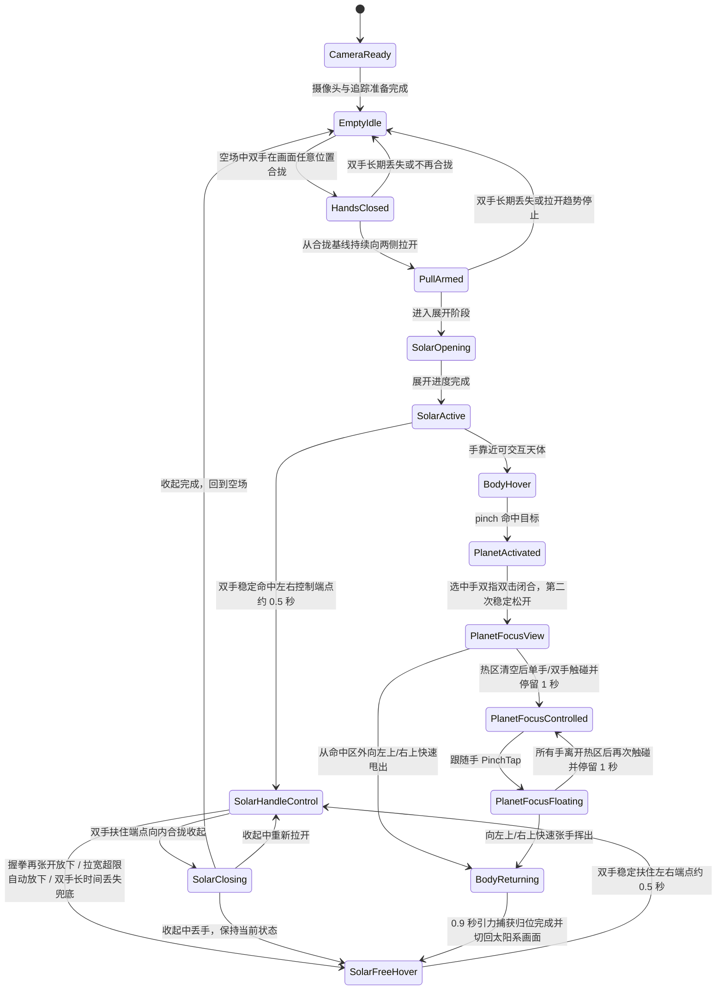

# 摄像头 AR 太阳系手势交互 Demo 产品需求文档

版本：v0.9（MVP 整理版）
日期：2026-07-04
阶段：MVP 演示效果已达成
目标形态：可演示的实时摄像头 AR 交互 Demo

## 1. 项目概述

基于普通摄像头的实时 AR 视觉交互 Demo：用户打开摄像头后，画面中显示用户本人，初始没有任何可见 3D 模型。用户在空场中将双手合拢再向两侧拉开，太阳系随双手距离被"拉"出来，展开为可被双手控制、松手后停在释放位置的 3D 太阳系。用户可以重新扶住左右端点整体控制或反向收起，也可以 pinch 激活行星进入单颗行星画面观赏、热区跟随、放下悬浮，最后朝左上角或右上角快速张手挥出返回轨道。

第一阶段不追求真实空间 AR 锚定，而是以摄像头画面为背景，通过手部关键点识别和 3D 渲染叠加，模拟出"太阳系像一个可被双手拉开、托住、移动并在松手处自由悬浮的空间物体"的视觉效果。

## 2. 一句话定义

一个打开摄像头即可体验的手控 AR 太阳系：初始无 3D 模型，双手合拢再拉开把太阳系从双手之间拉出来；释放后自由悬浮，可重新扶住端点控制或收起，可激活行星进入单颗行星画面观赏和跟随，并在放下悬浮稳定后通过朝左上角或右上角快速张手挥出回轨。

## 3. 产品目标

### 3.1 MVP 目标

1. 摄像头画面实时显示用户本人，初始无任何可见 3D 模型。
2. 用户在 `EmptyIdle` 空场中双手于画面任意位置合拢进入 `HandsClosed`，再从合拢基线向两侧拉开进入 `PullArmed`，太阳系随手部被拉出，左右展开端点吸附双手。
3. 太阳系展开后不固定在屏幕中心；松手后停在用户释放的位置和大小，整体保持固定斜俯视角。
4. 松手悬浮后，双手重新扶住左右端点可继续整体把手控制或反向收起。
5. 用户可以 hover 并 pinch 激活水星、金星、地月整体、火星、木星、土星、天王星和海王星（月球命中点映射为地月整体）。
6. 行星被激活后停止公转但保持自转；同一只激活手拇指/食指连续完成两次闭合点击，第二次闭合稳定松开后进入单颗行星画面。
7. 单颗行星画面中，当前行星始终自转，背景太阳系弱化并锁定交互但保留基础动效；单手/双手触碰热区停留 1 秒进入跟随，双手跟随用手距缩放；跟随手 PinchTap 放下悬浮。
8. 在 `PlanetFocusView` 或放下后等待 250ms 的 `PlanetFocusFloating` 中，任意一只手从星球命中区外完成一次朝左上角或右上角的连续快速张手甩出，行星用约 0.9 秒“引力捕获归位”动画沿弧线和轨道切线汇回原轨道并切回太阳系画面；跟手控制时禁用，单体星球界面不显示返回按钮。
9. 整个体验可以稳定录制 30-60 秒演示视频。

### 3.2 非目标

1. 真正的空间定位 AR。
2. 多人同时交互。
3. 精确物理模拟和天文学比例的科学级还原。
4. 移动端、Vision Pro、Quest 等 XR 设备适配。
5. 商业展厅级稳定性和复杂天文科普信息系统。

## 4. 目标用户与使用场景

| 用户类型 | 需求 |
|---|---|
| 创作者/演示者 | 做出一段一眼看懂的炫酷交互视频 |
| 科技课程讲解者 | 用身体和手势讲解太阳系 |
| Demo 制作者 | 快速验证 AR 手势交互玩法 |
| 互动视觉爱好者 | 体验摄像头驱动的 3D 空间交互 |

核心流程：打开网页、允许摄像头权限，画面中只出现用户本人和轻量 UI 提示。空场中双手合拢再拉开召唤太阳系；释放后悬浮，可重新扶住端点或反向收起；靠近行星高亮，pinch 激活后完成两次闭合点击并在第二次松开时进入单颗行星画面；热区停留跟随、PinchTap 放下，随后朝左上角或右上角快速张手挥出回轨。

## 5. 核心体验原则

1. **第一眼要像 AR**：太阳系一旦被双手释放，就保持在释放位置自由悬浮，不吸回胸前锚点或屏幕中心。
2. **开始时必须是空场**：初始只允许摄像头画面、极轻量 2D 提示文字和调试模式下的手部关键点；不允许任何预先显示的 3D 元素（奇点、太阳、轨道、星云、装饰物）。用户需要通过双手动作把太阳系"召唤"出来。
3. **展开必须跟手**：展开宽度和进度由双手距离驱动；手停住展开就停住，不自动播完。
4. **行星焦点是观赏状态**：激活、进入焦点、热区跟随、放下悬浮期间，焦点天体始终自转。放下只解除跟随控制，行星停留在焦点画面当前位置；悬浮稳定后可朝左上角或右上角连续快速张手挥出回轨，焦点界面不提供返回按钮。

## 6. 交互动作与系统反馈

| 动作 | 用户直觉 | 系统反馈 |
|---|---|---|
| 空场中双手在画面任意位置合拢 | 准备打开 | 仅在 `EmptyIdle` 进入 `HandsClosed`，无任何 3D 内容 |
| 从合拢基线向两侧拉开 | 拉出太阳系 | 进入 `PullArmed` 后，太阳系两端吸附双手并随距离展开 |
| 双手从展开两端向内合拢 | 收回太阳系 | 随手距反向收起，最终回到空场 |
| 整体控制中双手握拳再张开一次 | 放下太阳系 | 冻结在握拳前的稳定位置和大小，进入自由悬浮 |
| 整体控制中双手接近画面左右边缘并短暂停稳 | 达到上限自动放下 | 冻结在上限处的稳定 transform 并悬浮；单帧拉宽不触发 |
| 双手重新靠近两端并稳定约 0.5 秒 | 再次扶住 | 进入整体控制状态，不要求 pinch |
| 主手 pinch 命中行星 | 选中目标 | 行星激活，停止公转但继续自转 |
| 选中手双指双击闭合并松开 | 进入单颗行星画面 | 第二次闭合稳定松开后，当前行星成为主角，背景弱化并锁定交互 |
| 单手触碰热区停留 1 秒 | 单手跟随 | 行星跟随该手拇指/食指中点移动，不移出屏幕 |
| 双手触碰热区停留 1 秒 | 双手跟随 | 行星跟随两手中点；大小只由两手距离决定 |
| 跟随手 close-open PinchTap | 确认放下 | 行星悬浮在当前位置，仍在单颗行星画面 |
| 悬浮稳定后任意单手朝左上角或右上角连续快速张手挥出 | 快速送回太阳系 | 通过多帧方向、速度与追踪质量门槛后进入统一回轨动画；慢移、水平/垂直/向下移动、静态张手和边缘跳点不触发 |

## 7. MVP 功能范围

### 7.1 摄像头与真人背景

1. 摄像头画面以完整 16:9 预览显示，`object-fit: contain`，不裁切、前置镜像。
2. 上方叠加同尺寸透明 WebGL Canvas；视频、Canvas 和调试 overlay 必须共享同一显示尺寸，避免手势坐标错位。
3. 验收：允许权限后 1-3 秒内显示画面；不拉伸不裁切；初始无 3D 模型；调试面板可显示原始尺寸、显示尺寸、比例和 Canvas 尺寸。

### 7.2 身体相对参考（默认关闭）

肩部姿态识别只作为可选的初始视觉放置参考，不参与启动、松手、重新扶住或自由悬浮判定。由于当前没有任何判定使用身体参考，`PoseLandmarker` 默认关闭（`ENABLE_POSE_TRACKING`），把算力让给手部追踪；调试面板显示"未识别到身体"。未来真正使用时再以降频方式开启。

### 7.3 初始空场

1. 初始只显示摄像头画面和极简 2D 提示；不显示任何 3D 元素。
2. 只有 `EmptyIdle` 状态才允许把双手合拢解释为启动意图；启动检测不要求双手靠近胸前、肩膀或任何身体锚点。
3. 非空场状态下的双手合拢/拉开不会重新进入 `HandsClosed` 或 `PullArmed`。

### 7.4 双手吸附拉开太阳系

触发规则：

```text
条件 1：当前状态为 EmptyIdle 空场
条件 2：检测到左右手，初始距离小于近距阈值并稳定进入 HandsClosed
条件 3：只有从 HandsClosed 出发、双手距离在 0.2-1.5 秒内持续增大才进入 PullArmed
条件 4：最终手距相对合拢基线达到足够增量
条件 5：双手重叠导致一手短暂丢失时可锁存近期双手证据，但不能单手启动
条件 6：离开启动链路后，合拢/拉开交给当前场景状态解释
```

展开进度：

```text
openProgress = clamp((currentHandDistance - startHandDistance) /
                     (targetHandDistance - startHandDistance), 0, 1)
```

行为要求：

1. opening 状态下左右展开端点绑定双手位置；手距决定展开进度；手停住进度停住，不自动播完。
2. 双手保持合拢但不拉开时，不显示任何太阳系内容。
3. 展开完成或松开整体控制后，太阳系保持最后稳定位置和缩放，固定斜俯视角不变。
4. 快速撤手、双手靠近画面边缘或 MediaPipe 短暂误检导致端点突变时，保持最后稳定 transform，不突然缩小或跳动。
5. 双手扶住端点向内合拢驱动反向收起（`closeProgress = 1 - openProgress`）；收起完成后全部隐藏，回到空场。

验收：明显的"合拢再拉开"动作 80% 以上可触发，位置不限；展开两端明显跟手；只保持紧握不出现动画；松手悬浮不回中心；收起完成回到空场。

### 7.4.1 整体太阳系松手与重新扶住

1. 展开稳定后，双手扶住左右端点即整体控制（`SolarHandleControl`），端点吸附双手、随手移动和缩放。
2. 由于端点吸附双手，离开端点本身不是放下。放下只由三种方式触发：
   - **握拳→张开**：双手同时握拳进入放下预备（预备期间 transform 冻结，不被握拳拖动），再同时张开即放下；握拳后迟迟不张开则超时取消、恢复跟手。
   - **拉宽自动放下**：双手屏幕跨距达到接近整幅画面的上限（进入约 90%，回落约 86%）并稳定约 180ms 后自动放下，冻结在上限时刻的 transform；普通宽手位和单帧尖峰不触发。
   - **双手长时间完全丢失**：兜底放下，保持最后稳定位置；偶发单帧丢手不触发。
3. 放下进入 `SolarFreeHover`：悬浮在最后稳定位置和缩放，不回中心、不吸锚点，固定斜俯视角。
4. 重新扶住：双手靠近太阳系左右 3D 控制端点并稳定停留约 0.5 秒即重新进入整体控制；以端点邻近度为门槛，不要求 pinch 或特定手型；带迟滞避免反复进出。
5. 整体控制中双手向内合拢接近闭合阈值进入 `SolarClosing`，完成后回到空场。
6. 整体控制意图与行星 pinch 激活意图必须区分；强 pinch 倾向应降低整体控制置信度。

### 7.4.2 手势协议层与会话自适应阈值

1. MediaPipe 关键点与 Three.js 控制器之间有一层明确协议：`HandPrimitives → SessionCalibration → WholeSystemIntent → SolarSystemController`。协议层不直接渲染任何 3D 内容。
2. 基础特征层统一输出：左右手中心、手距、中点、轴向角度、手距速度、手掌尺度、追踪置信度、合拢/拉开意图分数。
3. 合拢阈值、拉开增量、端点半径、重新扶住磁吸半径和反向收起阈值优先由会话内校准（手掌尺度、首次合拢距离、自然拉开距离）推导；校准只存在内存中，刷新即重置，不保存长期数据、不引入后端。
4. 掌心朝向只作为意图置信度加分，不作硬性门槛；普通摄像头下掌心法线不可当作精确 3D 传感器。
5. 视觉左/视觉右端点以用户看到的镜像画面为准，不等同于 MediaPipe handedness。
6. startup 和整体控制协议输出结构化跳转原因；Debug 面板可显示基础特征、校准阈值、endpoint hit score 和各状态原因，用于解释为什么进入或没有进入某状态。
7. Debug recorder 可导出结构化 landmarks、基础特征、校准值、意图分数、状态和跳转原因 JSON；单颗行星焦点流程中必须包含 `planetFocus` 快照（焦点天体、控制状态/模式、触碰手数量、热区距离/半径、dwell 计时、跟随位置、缩放、PinchTap 状态和跳转原因），以及 `planetReturnWave` 快照（阶段、空间轨迹手、帧数、峰值速度、净位移、左上/右上方向分量、起点/终点距星球、终点距离趋势、命中半径、张手健全性、手掌尺度、分数和原因）。不记录原始视频、不上传数据；每次开始记录开启新 session 并清空旧帧。
8. 右上角中文状态说明以当前 `interactionState` 和太阳系控制器输出（`solarReason` / `openProgress` / scale）为准；旧协议值（`Lock`、`Re-grip`、`Transition` 等）只保留在 Debug 面板。

### 7.5 可交互天体

九个渲染天体、八个总览交互入口：

| 入口 | 说明 |
|---|---|
| 水星 / 金星 / 火星 / 木星 / 土星 / 天王星 / 海王星 | hover、pinch 激活、单颗行星画面、悬浮、快速扫动返回 |
| 地月整体 | 总览中地球和月球共用一个入口；命中月球也进入地月整体，焦点默认显示地球，仅此界面提供 0.5 秒长按切换月球/地球视角按钮 |

规则：允许简化纹理和演示比例；土星保留明显的环；月球默认作为地球子对象运动，不是总览独立入口；同一时间只允许激活或聚焦一个目标。使用统一天体数据模型和统一激活/焦点/返回管线，不为单个行星写一次性代码。

### 7.6 星球选择与高亮

1. 手部靠近可交互天体的屏幕投影位置时进入 hover：外圈光晕、中文名称标签、轨道线轻微变亮。
2. 多个天体接近时，优先屏幕距离最近且热区权重最高者；高亮不在多个天体间乱跳。
3. 小天体（水星）扩大交互热区；月球命中点映射为地月整体。

### 7.7 Pinch 激活行星

```text
pinchDistance = distance(thumbTip, indexFingerTip)
pinchStart = pinchDistance < tunedStartThreshold
pinchEnd   = pinchDistance > tunedEndThreshold
```

1. 开始/结束使用不同阈值（迟滞）避免临界闪烁；当前实现使用 `0.48 / 0.62` 的手掌尺度 ratio 阈值并叠加屏幕像素距离保护。
2. pinch 命中高亮天体的边界或扩展热区时进入 `PlanetActivated`：停止原轨道公转、保持自转；激活反馈明确（锁定光环、标签固定）。
3. 同一时间只有一个 `PlanetActivated`。地月绑定例外：激活地月整体时地球公转暂停，月球可继续绕地球公转。
4. 激活时以激活手手腕建立画面短边归一化的平移锚点；锚点、当前位移和速度统一使用手腕，hover 与落定仍使用锁定的指尖/pinch 交互点。原地开合手指不会被解释为手部平移；手腕连续两帧移出锁定范围后才进入寻找态，只有手速连续多帧降到落定阈值才提交。落定于另一热区时按归一化距离与 `HOVER_SWITCH_MARGIN` 滞回切换到该天体并让 A 立即恢复公转；移动途中经过的天体不切换，切换不要求张开或重新 pinch。
5. 激活期间整个太阳系背景不被拖动、不被缩放。

### 7.8 单颗行星画面

1. 激活后，同一只激活手拇指/食指的 DoubleClose 按归一化 `ratio` 时间序列识别为“谷 1 → 峰 → 谷 2”：两个闭合谷均不高于 `0.35`，中间重开峰不低于 `0.50`，且 `peak - max(valley1, valley2)` 的突出度至少为 `0.25`；每个谷和中间峰都至少连续出现 2 个新检测帧，两谷间隔不超过 `3800ms`。判定只使用按 `palmScale` 归一化的 ratio，不使用绝对像素指距，因此允许两次闭合深浅不一和仅持续 2 帧的谷底。第二次闭合只完成焦点进入准备，随后 ratio 重开并稳定至少 `70ms` 才进入 `PlanetFocusView`；初始激活 pinch 不计入，单次长按闭合因缺少中间显著峰而不成立。
2. 激活态的切换与取消共用手腕平移锚定：锁定范围内的手腕微调及原地手指开合不切换、不取消，也不打断 DoubleClose；即使邻近天体热区漂到手下或当前天体屏幕位置漂走，选择仍保持。手腕连续移出锚点后，仅在连续多帧低速落定时判断结果：命中新天体即切换，所有天体归一化距离均超过退出倍率并短暂稳定则取消，自然松弛手型不构成门槛。进入寻找态的抖动及重新落回同一天体不会清空已经确认的 DoubleClose 进度；真正切换或取消时才重置。原地拇指/食指 ratio 达到 `0.58` 并经过短暂退出停留，可作为明确放弃激活的备用路径。
3. 焦点画面中背景太阳系通过直接降低对象透明度弱化（不加覆盖摄像头的蒙版），锁定交互但保留公转自转等基础动效。
4. 使用统一焦点星球 overlay（按天体 metadata 驱动），不为每颗星球写单独界面。
5. 进入焦点时，行星从原位置和原尺寸出发，约 0.3 秒平滑移动放大到焦点位置；球体垂直居中，高度约占屏幕 1/2 到 2/3；使用无光照材质，无聚光灯式高亮斑。
6. 当前行星在激活、焦点、跟随、悬浮全程保持自转。
7. 带 `ring` 定义的焦点天体，其环与球体共用轴倾角但不跟随球体自转；环的椭圆长轴与球体条带方向一致，并按前后半环绘制，使远半环被球体遮挡、近半环覆盖在球体表面叠层之前景，同时两侧轮廓外弧完整可见。进入和返回过场统一继承焦点天体的位移、缩放与拉伸变换。

### 7.9 热区跟随、确认放下与悬浮

1. 用户通过触碰当前星球热区来"拿起"行星；不要求掌心朝上、低速或托住下缘等姿态条件。
2. **进场门闸**：进入焦点后先完成约 0.3 秒居中过渡，控制器进入视觉居中冷却（以星球实际接近屏幕中心为准，不按固定时间）；若进入时手已在热区内，必须先离开热区再重新触碰，才开始停留计时。
3. **单手跟随**：单手触碰热区稳定停留 1 秒进入；行星跟随该手拇指/食指中点移动，不移出屏幕（贴边悬停）。副手出现在画面中但停留在热区外不影响，控制保留在原手（即使手的内部编号因手数变化而改变，也按空间连续性重新锁定原手）。
4. **双手跟随**：双手同时触碰热区停留 1 秒进入；行星跟随两手中点移动，大小只由两手（各自拇指食指中点）之间的距离决定，与任一手自身的捏合无关——因此收拢手指既不缩放也不会被误判为放下；两手收拢可缩到比进入时明显更小。
5. **降级**：双手跟随中一手明显撤出热区、另一手仍在时，降级为留下那只手的单手移动控制（缩放冻结），行星不被撤出的手拽走；第二只手回到热区停留 1 秒可重回双手跟随。
6. **双手全部脱手**：两只跟随手都明显离开热区时短暂冻结位置和缩放抗抖；超过保护窗口仍无手回到热区则放下到悬浮，避免热区外粘连。
7. **PinchTap 放下**：拇指与任一手指靠拢再张开的确认动作，不需要再次命中热区。单手跟随中跟随手、双手跟随中任一跟随手完成 PinchTap 即放下。进入跟随前已闭合的手指不会因随后张开而立刻放下——控制器必须在跟随开始后先观察到张开，再接受一次新的 close-open。
8. **放下语义**：放下 = 解除跟随进入 `PlanetFocusFloating`，行星悬浮在当前位置继续自转，仍停留在单颗行星画面，不回轨、不解除背景锁定。
9. **热区清空**：放下后必须等所有可见手都离开热区，才重新进入待选中状态。
10. **计时容错**：1 秒停留计时对偶发单帧脱手不清零；超过容错窗口才重新计时。

### 7.10 快速挥手返回原轨道

1. 单体星球焦点界面不显示返回按钮，也不存在隐藏的按钮命中区域。返回入口在 `PlanetFocusView` 与 `PlanetFocusFloating` 生效，在 `PlanetFocusControlled` 禁用；焦点星球屏幕目标不可见或为空时不判定。
2. `PlanetFocusFloating` 进入后先等待 250ms，过滤 PinchTap 放下和脱手残余速度；`PlanetFocusView` 不增加准备计时。挥手候选的起点必须位于当前星球 `hitRadius × 1.2` 之外，并落在画面 8% 内边框以内；这个边界约束只检查起点，挥动终点可以越过内边框或飞出画面。
3. 挥手使用平滑后的手中心 2D 屏幕轨迹，并按画面短边归一化。统一判据全部同时成立：至少 3 个空间连续观测；峰值速度不低于 3.0 短边/秒；净位移不低于 0.35 短边；水平和向上分量各占净位移至少 0.32，形成朝左上或右上的单向甩出；最近 3 个观测的手到星球距离趋势为正，且终点仍在命中区之外；候选平均张手分数不低于 0.5，只用于排除明显捏合/握拳，不用于给有效挥手排序。速度中位数、整段净速度与直线度不作为返回门槛。
4. 手身份完全按空间轨迹匹配，不依赖 MediaPipe 左右手标签。最多约 150ms 的漏追踪可继续同一轨迹；重获半径为 `0.15 + 12 × gapSeconds` 短边，并同时要求相邻手掌尺度比在约 `0.60–1.67` 内、运动方向与丢帧前方向夹角小于 90°。重获后的跨 gap 位移与时间直接计入峰值速度和净位移；追踪断裂本身既不否决也不单独触发返回。
5. 普通 pinch 释放、低速伸手、持续逼近星球、水平/垂直/向下移动、PinchTap 放下、静态开掌、无法通过空间/尺度/方向校验的重识别，以及跟手控制中的快速移动都不得触发回轨。判定成立后进入 `BodyReturning`，手势输入保持冻结。焦点 overlay 用约 0.9 秒完成“引力捕获归位”：先沿挥手反方向轻微压缩蓄力，再按 `cornerDirection`、水平/向上位移和峰值速度向对应显示上角弹射；随后沿受视锥约束的三次 Bézier 弧线收束，并用目标天体逐帧世界位置差分得到的轨道切线完成末段汇入。无有效挥手快照的共用调用使用“太阳指向目标天体”的非零径向外抛和中等力度，不得退化为零向量或直线 NaN。
6. 返回视觉反馈包括：速度驱动的独立各向异性拉伸、加速后回落的自转、返回拖尾、3–4 个快速淡出的半透明残影；约 92% 进度在轨道面触发一次扩散涟漪、太阳 flare 短脉冲和目标轨道线临时 Bloom 高亮，尺寸轻微 overshoot 后稳定。新增发光对象走现有 Selective Bloom，不新建渲染管线；连续多次返回必须复用并清理拖尾、残影、涟漪和轨道脉冲。动画完成后才恢复原轨道层级、公转、背景不透明度和太阳系交互。

### 7.11 地月焦点视角切换

1. 地月整体进入焦点后默认显示地球 overlay。
2. 仅地月焦点界面显示左上角玻璃切换卡，文案随当前视角显示"长按切换月球视角"或"长按切换地球视角"；食指命中后显示进度，长按阈值 0.5 秒。
3. 切换卡使用与 `FOCUS CONTROL` 标题一致的青蓝强调色（`127, 216, 255`），保留现有科技玻璃底板、边框、扫描线和充能动效；桌面宽度约 344px，使用两列布局，圆形进度器位于左侧，主文案在右上，计时/状态在右下；窄屏自适应容器宽度。
4. 触发切换后必须先离开卡片区域才能再次触发，避免按住来回跳变。
5. 切换只改变焦点 overlay 和热区目标，不退出焦点画面、不触发回轨。
6. 其他行星焦点界面不显示该切换卡。

## 8. 视觉设计需求

### 8.1 整体风格

科幻、宇宙、真实 3D、发光轨道、手势魔法感、AR 悬浮、空间感、仪式感开场。

### 8.2 太阳系视觉组成

| 元素 | 要求 |
|---|---|
| 太阳 | 中心发光球体，带光晕 |
| 八大行星 | 各自可辨识的纹理特征；木星最大但不按真实比例碾压 |
| 月球 | 小型灰白球体，绕地球运动 |
| 土星环 | 明显可辨识 |
| 轨道 | 半透明发光圆环 |
| 星云/星尘 | 只在拉开后出现 |
| 标签 | hover、激活或焦点画面显示 |

### 8.3 撕裂宇宙空间视觉方案（当前实现）

太阳系总览采用强斜俯视宇宙裂口构图：

1. **固定视角**：盘面默认 X 轴约 `-79.58°`（约 `-1.38893 rad`，`SOLAR_SYSTEM_PREVIEW_TILT_X`）、Y 轴约 `5°`、Z 轴 `0°`。注意区分位置轴和旋转轴：圆盘上下压扁效果写在绕水平 X 轴的 pitch 上。AE 边界光环脚本中 `Vertical Tilt Degrees = 66.66°` 作用于已压扁的 `1500 x 600` 源椭圆；运行时必须用项目裂口基础尺寸 `10.5 x 9.2` 推导等效 pitch 才能保持屏幕观感一致。该角度是固定视觉视角，运行时整体控制只更新位置和缩放，不接受手势旋转或 quaternion 输入。
2. **演示比例**：天体尺寸和轨道布局以演示效果优先；小天体适当放大，保留一眼可读的大小差异。
3. **裂口构图**：双手拉开后，像从摄像头画面中撕开一块椭圆宇宙空间：椭圆外保留摄像头画面，椭圆内使用低存在感的半透明黑暗星系背景（少量深蓝、暖橙星云光和星点）。总览背景层统一使用 `SOLAR_BACKGROUND_OPACITY_SCALE = 0.68`，只降低裂口星空/星云、边界火花、星尘/拖尾和环境暖光；太阳、行星、月球、土星环、轨道、标签和控制端点保持原有透明度。
4. **边界光环**：椭圆边界用 AE 导出的透明 PNG 序列渲染（默认路径 `public/assets/solar/fx/rift-border-loop/png-sequence/`，附 `rift_border_loop.sequence.json` 描述帧率/帧数/尺寸/循环）。Three.js 用单个 `CanvasTexture` 按帧更新，不为 120 帧建 120 个 GPU texture。同一序列渲染为两层：底层普通透明混合的暗色支撑层（压住真实摄像头亮背景），顶层 additive 金蓝能量边界。不再新增额外 runtime glow pass、全局 bloom、独立光环自转/缩放或自动显示生命周期，除非用户明确批准。
5. **生命周期与对齐**：裂口背景、边界和星尘与太阳系组共用位置、缩放和显示生命周期，不得自己额外加缩放或绕 Z 自转；"出现"只用透明度淡入，"变大"由太阳系组整体缩放带动。AE PNG 已烘焙扁平椭圆角度，运行时边界 mesh 做本地反倾角补偿，避免被太阳系组默认 pitch 再次压缩；代码生成的内部星空背景使用同一 AE 全帧平面、同一本地反倾角和同一中心点，并缩进裁剪在光环内侧。
6. **渲染层级**：内部星空背景是底层宇宙底图，不能盖在太阳、行星、轨道或端点上；必须放到专用底层 render layer 先渲染，然后清除深度再渲染主太阳系和 AE 光环，使天体始终浮在背景圆盘之上。
7. **可见度**：太阳、行星、轨道和控制端点保持 100% 可见度，不被椭圆背景压暗；天体可突破椭圆边界，边界不裁切星球。左右控制端点位于椭圆左右最宽边缘（`SOLAR_SYSTEM_CONTROL_ENDPOINT_LOCAL_X = UNIVERSE_RIFT_WIDTH / 2`），与发光边界对齐。
8. **AE 表达式约束**：边界光环所有呼吸、弧线漂移和扰动 evolution 必须用周期表达式首尾闭合，不能用非整数线性时间漂移，否则 4 秒循环回到第一帧会跳变。AE 工程和导出脚本在 `scripts/after-effects/`。

### 8.4 视觉效果阶段的交互保护规则

视觉效果工作默认只做表现层升级（材质、纹理、光照、辉光、粒子、星云、拖尾、标签、UI 质感、录屏模式、渲染性能），必须叠加在现有行为之上。除非用户明确要求，不得修改已测试通过的交互逻辑、状态机流转、手势阈值、对象出现/隐藏时机和各交互语义。若视觉目标确实需要改交互，必须先说明行为变化、影响范围和风险，取得明确许可后再改。

## 9. 交互状态机



## 10. 技术方案

| 模块 | 方案 |
|---|---|
| 摄像头输入 | Browser MediaDevices API |
| 手部识别 | MediaPipe Hand Landmarker（独立 Web Worker；沿用 33ms 检测节拍、单帧在途） |
| 姿态识别 | MediaPipe Pose Landmarker（默认关闭） |
| 3D 渲染 | Three.js |
| 构建 | Vite + TypeScript |
| 动画 | Three.js 内置插值 |
| Demo 形态 | Web 页面 |

可选升级方向（非 MVP）：Ultraleap/深度摄像头、Unity、TouchDesigner、Unreal、Vision Pro/Quest。

## 11. 数据与坐标映射

### 11.1 输入数据

| 数据 | 用途 |
|---|---|
| 手掌中心 | 展开端点、热区触碰、跟随锚点 |
| 手腕 | 激活态切换/取消的平移锚点、位移与速度 |
| 拇指/食指指尖 | pinch、PinchTap、地月切换卡命中 |
| 左右手距离 | 拉开展开、端点重新扶住、反向收起、双手跟随缩放 |
| 手掌尺寸 | 辅助估算深度和 pinch 阈值 |
| 手部稳定性 | 各手势稳定性判断 |
| 左右肩关键点 | 可选身体参考（默认关闭） |
| 太阳系 position/scale | 松手后保持悬浮；总览角度由视觉层固定 |

### 11.2 映射原则

不做真实深度重建；手部坐标从摄像头归一化坐标映射到 Three.js 场景平面（`coordinateMapping.ts` 是唯一入口，感知镜像和 `object-fit: contain`），用相对 Z、手掌大小和运动规则模拟空间深度。

### 11.3 平滑策略

1. 手部位置：低通滤波 + 丢帧保持；启动阶段可短时锁存双手合拢证据。
2. 展开进度：跟随手距，限制最大变化速度。
3. pinch 状态：迟滞阈值。
4. 屏幕平面手势距离只用 2D x/y，不用 MediaPipe 图像 z；手型判断优先 world landmarks。
5. 重要手势动作不做单帧翻转；地月切换卡与演示页手部模型开关都要求食指尖稳定停留 0.5 秒，触发后需先离开卡片才能再次触发。

## 12. 关键参数

| 参数 | 建议值 | 说明 |
|---|---:|---|
| 双手合拢距离阈值 | 约 0.15-0.22 | 优先由会话校准推导 |
| 拉开触发增量 | 约 0.08-0.15 | 优先由会话校准推导 |
| 端点匹配半径 | 约 0.16-0.34 | 整体控制/松手/重新扶住 |
| 反向收起阈值 | 约 0.19-0.34 | 区分普通靠近和彻底收起 |
| pinch 开始/结束阈值 | 手掌尺度 ratio `0.48 / 0.62` | 迟滞，叠加屏幕像素保护 |
| 热区停留时间 | 1s | 进入单手/双手跟随 |
| 地月切换按钮停留时间 | 0.5s | 触发后需先离开再触发 |
| 地月切换卡宽度 | 桌面约 344px | 两列布局，窄屏自适应容器 |
| 演示页手部模型按钮停留时间 | 0.5s | 切换骨架显示/隐藏；默认关闭，触发后需先离开 |
| 焦点进场过渡 | 0.3s | 原位置到居中 |
| 返回挥手 | 峰值速度 ≥3.0 短边/秒、净位移 ≥0.35 短边 | 至少 3 个轨迹观测，起点在 `hitRadius × 1.2` 外，末段远离星球 |
| 返回挥手丢帧续接 | 最多约 150ms | 自适应空间半径 + 手掌尺度 + 方向一致性 |
| 回轨调整动画 | 0.5s | 焦点回到轨道位置和大小 |
| 手部丢失保持 | 约 2s | 防短时遮挡闪断 |
| 帧率目标 | 摄像头 30fps / 渲染 30-60fps | |

实际调参入口：所有整体手势阈值集中在 `src/interaction/intentTuning.ts`。

## 13. 页面与操作流程

页面结构：启动页（标题 + "开启摄像头"按钮 + 提示）→ 交互页（16:9 摄像头预览、右上角中文状态说明、左下角可开关调试面板）。

演示地址：`?demo=1` 进入纯演示模式，隐藏右上角 Debug 按钮、完整中文状态说明卡和底部手势提示文字，交互行为不变。右上角改为青色精简操作 HUD，只显示当前操作标题，不显示状态描述、原因、参数或端点诊断；`PlanetActivated` 显示“{中文名}已激活”，`PlanetFocusControlled` 显示“正在控制{中文名}”，`PlanetFocusFloating` 显示“{中文名}悬浮中”，且地月切换后跟随当前实际焦点天体；进入 `PlanetFocusView` 时标题显示当前天体的“中文名（英文名）”（地月切换后同步更新）。其下方显示青色“长按显示手部模型”卡，食指尖稳定停留 0.5 秒后切换手部骨架显示/隐藏。两张卡在桌面端统一为约 344px 宽、共享 16:9 摄像头预览区域内的右边缘与纵向间距基准，窄屏改为同宽单列。操作状态卡、手部模型卡和地月切换卡统一使用青色边框、四角、文字与环形进度柔光，长按充能时增强光晕和扫描光，但不对摄像头画面增加滤镜或遮罩。骨架默认关闭且仅绘制手部地标，不绘制太阳系虚拟端点；每次触发后需先离开卡片才能再次切换。默认地址保留全部调试 UI，不显示演示专用开关卡。

调试面板内容：FPS、追踪状态、当前状态、openProgress、整体控制状态与各置信度、虚拟端点与匹配状态、pinch 状态、激活/聚焦天体、焦点控制快照（模式、热区、dwell、PinchTap）、快速返回挥手快照（阶段/手/帧数/位移/速度/一致性/张手/尺度/原因）、显示/Canvas 尺寸、性能诊断值（render/tracking/controller/solar 各项耗时，仅用于定位卡顿）。

用户流程：开摄像头 → 空场 → 双手合拢再拉开 → 太阳系吸附双手展开 → 放下悬浮 → 重新扶住/收起，或 hover + pinch 激活行星 → 双击闭合并在第二次松开时进焦点 → 热区停留跟随 → PinchTap 放下悬浮 → 向左上/右上快速张手挥出回轨。

## 14. 验收标准

### 14.1 基础验收

| 编号 | 验收项 | 标准 |
|---|---|---|
| A1 | 摄像头启动 | 正常打开并显示真人画面 |
| A2 | 初始空场 | 打开后无任何可见 3D 模型 |
| A3 | 吸附拉开 | 仅 `EmptyIdle` 合拢再拉开可触发，两端跟随双手展开 |
| A4 | 自由悬浮 | 松手后停在释放位置，不回屏幕中心 |
| A5 | 放下/重扶/收起 | 握拳张开放下；0.5 秒端点停留重扶；向内合拢收起回空场 |
| A6 | 天体高亮 | 手靠近入口高亮；月球命中映射地月整体 |
| A7 | 行星激活 | 八个入口均可 hover + pinch 激活；激活停公转保自转 |
| A8 | 单颗行星画面 | 双击闭合后保持原界面，第二次闭合稳定松开才进入焦点；0.3 秒过渡；垂直居中 1/2-2/3 屏高 |
| A9 | 热区跟随 | 单手/双手 1 秒停留进入跟随；双手手距缩放 |
| A10 | 确认放下 | 跟随手 PinchTap 后悬浮在当前位置 |
| A11 | 返回太阳系 | 焦点界面无返回按钮；`PlanetFocusView` 或放下稳定后的 `PlanetFocusFloating` 从星球命中区外朝左上角或右上角快速甩出回轨，跟手控制时禁用；约 0.9 秒内按挥手方向/力度弹射、弧线捕获并沿轨道切线汇入，随后切回太阳系画面 |
| A12 | 地月切换 | 地月焦点内显示约 344px 两列切换卡，0.5 秒长按切换地球/月球视角，沿用原视觉样式 |
| A13 | 演示页 HUD | `?demo=1` 只显示当前操作标题；无原因/参数；0.5 秒长按卡可切换仅手部骨架，默认关闭且需离开后再触发 |
| A14 | 录屏 | 可完成 30-60 秒连续演示 |

### 14.2 体验验收

1. 第一次观看的人能理解"太阳系是从用户双手之间被拉出来的"。
2. 展开过程能看出两端吸附在双手上。
3. 激活任意星球都有明确反馈；松开后星球停在空中不被误解为失败。
4. 快速扫动返回有明确回归动画；地月切换卡有明确的长按进度反馈。
5. 演示过程不需要频繁解释就能看懂。

## 15. 风险与应对

| 风险 | 应对 |
|---|---|
| 普通摄像头无真实深度 | 相对 Z、手掌尺寸、光效和平滑模拟 |
| 双手拉开误触发 | 合拢稳定时间、近距阈值、连续拉开趋势、丢手保持 |
| 小天体难激活 | 扩大水星热区；月球命中映射地月整体 |
| 松开不回轨被误解 | 状态文案提示先放下悬浮，再朝左上角或右上角快速张手挥出返回太阳系 |
| 返回误触发 | 只在被动焦点状态接受多帧大位移、高峰值速度、斜向上、起点离开命中区且末段远离星球的甩出；跟手状态、伸手靠近、静态张手与未通过空间续接校验的跳点均禁用；焦点界面不保留按钮返回路径 |
| 画面与 3D 错位 | 镜像、坐标映射、端点反复校准 |
| 性能不足 | 限制粒子、降低后处理 |

## 16. 已退役语义（不再实现，勿恢复）

以下方案经用户确认淘汰；除非用户明确重新启用，不作为验收项、不重新实现：

1. `SolarFreeHover` 后的 M5.5 单手观察控制：五指张开放大、收拢缩小、握拳复位、单手推动平移。
2. 旧版整体缩放/旋转：双手距离缩放、掌心朝前"推拉玻璃窗"缩放、掌心朝上整体 3D 旋转。
3. 开掌松手 / 掌心朝上托举保护 / 释放锁作为产品放下手势（仅保留为 debug 诊断）。
4. pinch-and-throw 甩回和旧版静态掌心朝屏幕五指伸直返回；当前 `PlanetFocusView` / `PlanetFocusFloating` 从星球命中区外向左上/右上动态快速张手甩出是独立语义，必须保留多帧峰值运动、方向、末段远离星球与空间续接质量门槛。
5. 单颗行星焦点内的旧版单手缩放、平移、握拳复位。
6. 月球作为总览独立激活入口。
7. `verify:m5.5` 验证脚本及其 harness。

## 17. 后续增强方向

- 交互：星球信息面板、双手展开剖面、多天体同时悬停、一键召回。
- 视觉：太阳耀斑体积光、更复杂星云、粒子拖尾、手部能量场。
- 产品化：Electron 桌面版、录屏导出、主题切换、教学模式、展厅大屏模式。
